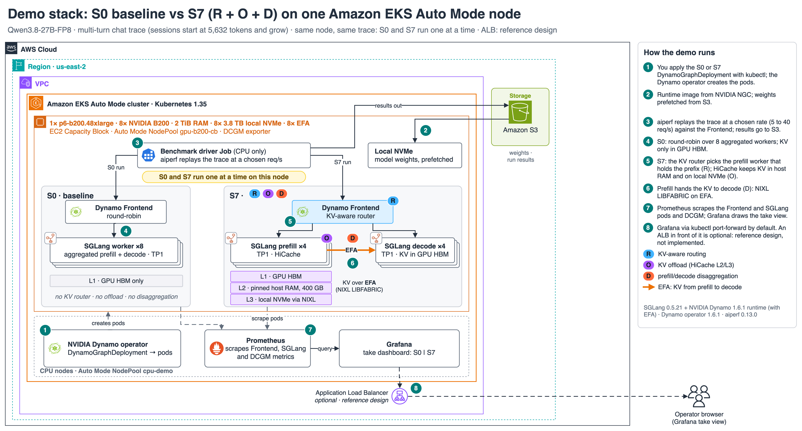

# Optimizing self-hosted LLM inference on Amazon EKS with NVIDIA Dynamo

> **Educational use only.** This is AWS sample code, provided for educational purposes only and not for production use.
> It has not been hardened or reviewed for your security, compliance or availability needs.
> It downloads model weights from Hugging Face, and the Dynamo operator Helm chart and the runtime image from NVIDIA NGC. Both are third-party
> services with their own terms, licenses and pricing: review the terms (and the model license) before you use them.
> Running the sample creates AWS resources that cost money, GPU capacity above all. You are responsible for the cost
> until you tear the resources down.

## What it is

A teaching sample of three NVIDIA Dynamo inference optimizations on Amazon EKS Auto Mode, alone and combined, on one
GPU node that serves `Qwen/Qwen3.8-27B-FP8` at TP1 (one engine per GPU). The manifests select one `p6-b200.48xlarge`
(8x NVIDIA B200):

- **R** = KV cache-aware routing: the Dynamo Frontend's KV router (`DYN_ROUTER_MODE=kv`) instead of round-robin.
- **O** = SGLang HiCache: KV offload from GPU memory to host RAM (L2) and local NVMe (L3, through NIXL). Dynamo KVBM is not used.
- **D** = prefill/decode disaggregation: 4 prefill + 4 decode workers, with the KV moved over NIXL LIBFABRIC on EFA ([Elastic Fabric Adapter](https://docs.aws.amazon.com/AWSEC2/latest/UserGuide/efa.html)).

Every on/off combination is one cell, S0 (none) to S7 (all three), with the same model, image and GPUs.
Each cell is one manifest; all eight are ready to apply in [examples/](examples/). To load a cell and measure it, see
[docs/BENCHMARKING.md](docs/BENCHMARKING.md). The repository also holds
the Terraform for the whole platform, the model staging Job, Grafana dashboards and an offline test suite.

## Architecture



Source: [docs/static/architecture.drawio](docs/static/architecture.drawio) (draw.io). Icons: AWS Architecture Icons;
the project logos and their licenses are listed in [docs/static/LICENSES.md](docs/static/LICENSES.md).

The figure puts S0 (no technique) next to S7 (R + O + D) on the same EKS Auto Mode GPU node, one at a time. The staging
Job copies the weights from Hugging Face to the S3 model bucket and the prefetch Job copies them from S3 to the node.
Prometheus collects the metrics and Grafana shows them; the benchmark driver Job that the figure draws is
[benchmarks/perf.yaml](benchmarks/perf.yaml). The figure is not a measurement. In the PD cells the prefill pod hands the
KV to the decode pod with NIXL LIBFABRIC over EFA: the manifests set it, and we observed it only on one
`p5en.48xlarge` with one prefill and one decode worker; it is not tested on `p6-b200.48xlarge` nor across two nodes
([Not tested here](docs/optimizations/pd-disaggregation/README.md#not-tested-here)). The node box shows what
`aws ec2 describe-instance-types --instance-types p6-b200.48xlarge` returns (2 TiB, 8 disks of 3,800 GB, 8 EFA). The load
Job was run in full on S0 only ([Not tested](docs/BENCHMARKING.md#not-tested)). The Application Load Balancer (ALB) in front of
Grafana is a **reference design** that this sample does not ship (see below).

- `terraform/bootstrap` creates the model and results buckets. `terraform/cluster` creates the VPC (one NAT gateway),
  EKS Auto Mode, the `cpu-demo` pool, one GPU NodeClass/NodePool per group of GPU types, the namespaces, the EKS Pod
  Identity roles (no static keys), Prometheus/Grafana with the dashboards, and the Dynamo operator.
- A DynamoGraphDeployment (DGD) per cell runs the Frontend and the SGLang workers on the GPU node. Only
  one cell holds the GPUs at a time. The weights are copied once from S3 to the node's NVMe.
- Grafana is reached with `kubectl port-forward`. The figure shows an Application Load Balancer (ALB) in front of Grafana
  as a reference design that is still to be implemented. The Terraform edge (`enable_grafana_edge`, off by default) still
  implements CloudFront + AWS WAF + an internal NLB.

## Versions

| Component | Version | Notes |
|---|---|---|
| Model | `Qwen/Qwen3.8-27B-FP8` at revision `017b9c7af6b5689d5dd426a76e0bc077eb5ca20a` | You download the weights from Hugging Face; they are never shipped here. |
| SGLang runtime | `nvcr.io/nvidia/ai-dynamo/sglang-runtime:1.6.1-efa`: SGLang 0.5.21, Dynamo 1.6.1, NIXL 1.5.0, EFA 1.50.0, pinned by digest (`sha256:bc30725d…`) in `versions.env` | The image the Frontend and the workers run. |
| Dynamo runtime | `ai-dynamo` 1.6.1, in the runtime image | Frontend, KV router and the SGLang worker wrapper. |
| Dynamo operator | Helm chart `dynamo-platform` 1.6.1; every component sets `runtimeVersionOverride: "1.6.1"` | Same version as the runtime. |
| EFA | 1.50.0, in the runtime image | D moves the KV between pods over LIBFABRIC on EFA. |
| NIXL | 1.5.0 | KV transfer for D (LIBFABRIC) and the HiCache L3 tier (POSIX backend). |
| Amazon EKS | Auto Mode, Kubernetes 1.35 | Terraform modules: EKS 21.15.1, VPC 6.6.0. |
| Terraform | >= 1.12; tested with 1.12.2 and 1.17.0 | Older versions fail to plan GPU types without EFA. |
| Observability | kube-prometheus-stack 69.7.4, dcgm-exporter 4.8.4 | Helm charts. |

`versions.env` pins the runtime image as
`RUNTIME_IMAGE=nvcr.io/nvidia/ai-dynamo/sglang-runtime:1.6.1-efa@sha256:bc30725d441e32406f2ee237bb3f0b720b105ca3b7f0c43b3d68918a23a5a954`.

## Prerequisites

- An AWS account and an IAM identity that can create VPC, EKS, IAM, S3 and CloudWatch Logs resources
  ([docs/DEPLOY.md](docs/DEPLOY.md#prerequisites) lists the extra read permissions).
- GPU capacity that you buy yourself: an EC2 Capacity Block. The manifests select one `p6-b200.48xlarge` (pool
  `gpu-b200-cb`); we applied them on `p5en.48xlarge` only (pool `gpu-h200-cb`, see
  [step 6](docs/DEPLOY.md#6-deploy-one-cell-examples)), and `p6-b200.48xlarge` was not tested with these manifests.
  Terraform never buys capacity.
- Workstation tools: see [Prerequisites](docs/DEPLOY.md#prerequisites).
- A Hugging Face account and a read token only for gated models; public models need no token.
- Pull access from the cluster to `nvcr.io` for the public runtime image ([size](docs/DEPLOY.md#prerequisites)).

## Security notes

The PD workers are not privileged, but the examples mount `hostPath` volumes, so the namespaces run at the Pod Security
`privileged` level; the workers run as root and the repository creates no `NetworkPolicy`. What each part allows, and
what was and was not tested, is in [docs/DEPLOY.md](docs/DEPLOY.md#security-notes).

## The three variables

Every user choice is in one file, `terraform/cluster/terraform.tfvars` (copy it from `terraform.tfvars.example`):

| Variable | tfvars keys | Validated value |
|---|---|---|
| REGION | `aws_region` | Any region that offers the GPU type. |
| GPU | `gpu_instance_types`, `gpu_capacity_type`, `capacity_reservation_ids` | `p6-b200.48xlarge` on a Capacity Block (pool `gpu-b200-cb`). |
| MODEL | `model_id`, `model_revision` (a 40-character commit SHA) | `Qwen/Qwen3.8-27B-FP8` at `017b9c7a…`. |

The values flow one way: tfvars, then `terraform apply`, then `terraform output` (`platform_env`, `sample_env`), then
`python3 scripts/gen_env.py`, which writes `manifests/config/platform.env` (read by the scripts).
The file is generated and gitignored;
`manifests/config/platform.env.example` shows the format with placeholder values. `gen_env.py` refuses another GPU
shape or model unless you pass `--allow-untested`, because the manifests select `gpu-b200-cb` and 8 GPUs per node.

## Quick start

Fill in `terraform/bootstrap/terraform.tfvars` and `terraform/cluster/terraform.tfvars` first, from their
`terraform.tfvars.example`. In the cluster file, set `eks_public_access_cidrs` to your egress IP and, for the example's
`gpu_capacity_type = "capacity-block"`, `capacity_reservation_ids` to your Capacity Block ID:
`terraform/cluster/variables.tf` rejects the shipped `<YOUR_EGRESS_IP>/32` and `[]`.
The cluster example already sets `runtime_image` to the public image pinned in `versions.env`. For a gated model, also
`export HF_TOKEN=<read token>` in the same shell. [Step 4 of docs/DEPLOY.md](docs/DEPLOY.md#4-stage-the-model-scripts10-stage-modelsh)
explains the `STAGE_IMAGE` digest used below. The full procedure is in [docs/DEPLOY.md](docs/DEPLOY.md).

```bash
terraform -chdir=terraform/bootstrap init && terraform -chdir=terraform/bootstrap apply
terraform -chdir=terraform/cluster init && terraform -chdir=terraform/cluster apply
eval "$(terraform -chdir=terraform/cluster output -raw configure_kubectl)"
python3 scripts/gen_env.py
export KUBE_CONTEXT="$(terraform -chdir=terraform/cluster output -raw cluster_name)" STAGE_IMAGE="public.ecr.aws/docker/library/python:3.12-slim@$(crane digest public.ecr.aws/docker/library/python:3.12-slim)"
scripts/10-stage-model.sh && scripts/11-prefetch.sh --wait
kubectl --context "$KUBE_CONTEXT" apply --server-side -f examples/00-baseline/manifest.yaml
```

The last command deploys S0. Delete it before you apply another folder of [examples/](examples/): only one cell fits on
the GPU node at a time.

## Repository layout

| Path | Content |
|---|---|
| `terraform/` | `bootstrap/` (S3 buckets) and `cluster/` (VPC, EKS Auto Mode, GPU pools, Dynamo, observability): [terraform/README.md](terraform/README.md) |
| `scripts/` | `gen_env.py`, `10-stage-model.sh`, `11-prefetch.sh` and `90-teardown.sh` |
| `manifests/` | `config/` (the platform env) and `node-ops/` (Kustomize: the prefetch Job and its helper pod) |
| `examples/` | [examples/](examples/): one folder per cell, all eight (S0 to S7), with its `manifest.yaml` and its README |
| `tools/` | `stage_model/` (staging Job) |
| `benchmarks/` | the `perf.yaml` Job and the request traces: [docs/BENCHMARKING.md](docs/BENCHMARKING.md) |
| `dashboards/` | Grafana dashboards, loaded by Terraform: [dashboards/README.md](dashboards/README.md) |
| `docs/` | `DEPLOY.md`, `BENCHMARKING.md`, `TROUBLESHOOTING.md` and `optimizations/` (one guide per technique) |
| `tests/` | The offline contract tests of manifests, scripts, Terraform, dashboards and docs |

## Cost and teardown

You pay for everything that runs, idle time included: the GPU instance or its reservation (a Capacity Block is paid up
front, an ODCR bills whether or not a node runs), the EKS control plane, the Auto Mode fee per node, the `cpu-demo` and
system nodes, the NAT gateway (per hour and per GB), EBS, S3 and CloudWatch Logs. Without a GPU node the idle
cluster costs about US$ 0.43 per hour in us-east-2, at On-Demand list prices as of 2026-10-27, excluding data transfer:
the breakdown and the pricing pages are in [docs/DEPLOY.md](docs/DEPLOY.md#teardown). For your region, use the
[AWS Pricing Calculator](https://calculator.aws/).

Teardown order, with the commands, is in [docs/DEPLOY.md](docs/DEPLOY.md#teardown): delete the DGDs and GPU
NodeClaims, destroy `terraform/cluster`, empty the buckets, then destroy `terraform/bootstrap`. After a failed or
partial apply, `scripts/90-teardown.sh --from-terraform` reads the values it needs from the terraform outputs.

## Documentation

- [docs/DEPLOY.md](docs/DEPLOY.md): the full procedure, from the buckets to the teardown.
- [docs/BENCHMARKING.md](docs/BENCHMARKING.md): load one cell with the benchmark trace, by hand.
- [docs/TROUBLESHOOTING.md](docs/TROUBLESHOOTING.md): known issues and the staging Job exit codes.
- Optimization guides: [KV router](docs/optimizations/kv-router/README.md), [HiCache](docs/optimizations/hicache/README.md),
  [PD disaggregation](docs/optimizations/pd-disaggregation/README.md).
- [terraform/README.md](terraform/README.md) and [tools/stage_model/README.md](tools/stage_model/README.md).
- [CONTRIBUTING.md](CONTRIBUTING.md) and [SECURITY.md](SECURITY.md) (report security issues privately).

## License

This sample is licensed under the MIT-0 License: see [LICENSE](LICENSE). The repository also contains third-party
material, copied or derived from other projects: the two NVIDIA Dynamo dashboards, the SGLang dashboard of NVIDIA
Dynamo, the NVIDIA DCGM Exporter dashboard, the DCGM metrics list of NVIDIA Dynamo, and the logos and icons of the
architecture diagram in `docs/static/`. [THIRD-PARTY-LICENSES.md](THIRD-PARTY-LICENSES.md) lists each item with its
upstream, license and changes, and the software the sample uses but does not contain; the Apache-2.0 attribution
notices are in [NOTICE](NOTICE), and the logos and icons are listed in [docs/static/LICENSES.md](docs/static/LICENSES.md).
The model weights are not distributed here and carry their own license.
