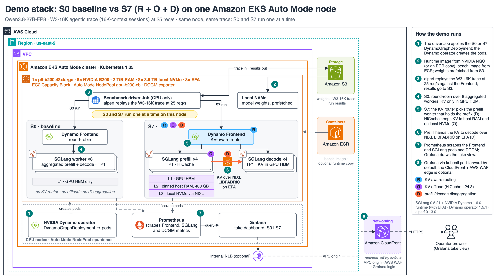

# Optimizing self-hosted LLM inference on Amazon EKS with NVIDIA Dynamo

> **Educational use only.** This is AWS sample code, provided for educational purposes only and not for production use.
> It has not been hardened or reviewed for your security, compliance or availability needs.
> It downloads model weights from Hugging Face, and the Dynamo operator Helm chart and the runtime image from NVIDIA NGC. Both are third-party
> services with their own terms, licenses and pricing: review the terms (and the model license) before you use them.
> Running the sample creates AWS resources that cost money, GPU capacity above all. You are responsible for the cost
> until you tear the resources down.

## What it is

A reproducible benchmark of three NVIDIA Dynamo inference optimizations on Amazon EKS Auto Mode, measured alone and
combined on one `p6-b200.48xlarge` (8x NVIDIA B200) that serves `Qwen/Qwen3.8-27B-FP8` at TP1 (one engine per GPU):

- **R** = KV cache-aware routing: the Dynamo Frontend's KV router (`DYN_ROUTER_MODE=kv`) instead of round-robin.
- **O** = SGLang HiCache: KV offload from GPU memory to host RAM (L2) and local NVMe (L3, through NIXL). Dynamo KVBM is not used.
- **D** = prefill/decode disaggregation: 4 prefill + 4 decode workers, with the KV moved over NIXL LIBFABRIC on EFA.

Every on/off combination is one cell, S0 (none) to S7 (all three), with the same model, image, GPUs and trace.
Each cell is a Kustomize overlay; all eight are ready to apply in [examples/](examples/). The repository also holds
the Terraform for the whole platform, the model staging Job, an in-cluster matrix driver, Grafana dashboards and an
offline test suite.

## Architecture



Source: [docs/static/architecture.drawio](docs/static/architecture.drawio) (draw.io). Icons: AWS Architecture Icons;
the project logos and their licenses are listed in [docs/static/LICENSES.md](docs/static/LICENSES.md).

The figure puts S0 (no technique) next to S7 (R + O + D) on the same EKS Auto Mode GPU node, one at a time. The staging
Job copies the weights from Hugging Face to the S3 model bucket and the prefetch Job copies them from S3 to the node.
The matrix driver Job replays the trace with aiperf against the Frontend and uploads the results to the results bucket;
Prometheus collects the metrics and Grafana shows them.

- `terraform/bootstrap` creates the model and results buckets. `terraform/cluster` creates the VPC (one NAT gateway),
  EKS Auto Mode, the `cpu-demo` pool, one GPU NodeClass/NodePool per group of GPU types, the namespaces, the EKS Pod
  Identity roles (no static keys), an ECR repository for the bench image (plus an optional one for a copy of the
  runtime image), Prometheus/Grafana with the dashboards, and the Dynamo operator.
- A DynamoGraphDeployment (DGD) per cell runs the Frontend on `cpu-demo` and the SGLang workers on the GPU node. Only
  one cell holds the GPUs at a time. The weights are copied once from S3 to the node's NVMe.
- Grafana is reached with `kubectl port-forward`. A CloudFront + AWS WAF edge exists in Terraform and is off by default.

## Versions

| Component | Version | Notes |
|---|---|---|
| Model | `Qwen/Qwen3.8-27B-FP8` at revision `017b9c7af6b5689d5dd426a76e0bc077eb5ca20a` | You download the weights from Hugging Face; they are never shipped here. |
| SGLang runtime | `nvcr.io/nvidia/ai-dynamo/sglang-runtime:1.6.0-efa`: SGLang 0.5.21, Dynamo 1.6.0, NIXL 1.5.0, EFA 1.50.0, pinned by digest (`sha256:d574951b…`) in `versions.env` | The image the Frontend and the workers run. The results below were measured with a derived SGLang 0.5.22 build. |
| Dynamo runtime | `ai-dynamo` 1.6.0, in the runtime image | Frontend, KV router and the SGLang worker wrapper. |
| Dynamo operator | Helm chart `dynamo-platform` 1.5.1; every component sets `runtimeVersionOverride: "1.6.0"` | The 1.5.1 operator runs the 1.6.0 runtime. |
| EFA | 1.50.0, in the runtime image | D moves the KV between pods over LIBFABRIC on EFA. |
| NIXL | 1.5.0 | KV transfer for D (LIBFABRIC) and the HiCache L3 tier (POSIX backend). |
| Amazon EKS | Auto Mode, Kubernetes 1.35 | Terraform modules: EKS 21.15.1, VPC 6.6.0. |
| Terraform | >= 1.12; tested with 1.12.2 and 1.17.0 | Older versions fail to plan GPU types without EFA. |
| aiperf | 0.13.0 | Load generator, in the bench image. |
| Observability | kube-prometheus-stack 69.7.4, dcgm-exporter 4.8.4 | Helm charts. |
| NGC image `sglang-runtime:1.5.1` (not used) | SGLang 0.5.18 with Dynamo 1.5.1 | Dropped 1 of 16 L3 restores of this model (see below). |

`versions.env` pins the runtime image as
`RUNTIME_IMAGE=nvcr.io/nvidia/ai-dynamo/sglang-runtime:1.6.0-efa@sha256:d574951b0dbd037bdcaabe121431a83cd047a5c106cb243fe6f2f97f2e456cd2`.
HiCache restore correctness was validated on 0.5.21 (RTX PRO 6000, batch size 1) and on 0.5.22 (B200): both restored
this hybrid model's KV from L2 and L3 in 16 of 16 probes, while 0.5.18 dropped 1 of 16 L3 restores. The results below
were measured with a derived SGLang 0.5.22 build (a Dynamo 1.6.0 nightly) that is not distributed; the cells, flags and
trace are the ones of this repository. The workers set `DYN_FORWARDPASS_METRIC_PORT=""`: without it the derived 0.5.22
build crashed on the first decode. On the public image, the Dynamo path (the Frontend with the KV router and one worker
with HiCache L2 + L3) was validated on a single RTX PRO 6000 node; PD over EFA, 8 workers and B200 were not re-measured
with it.

## Prerequisites

- An AWS account and an IAM identity that can create VPC, EKS, IAM, S3, ECR and CloudWatch Logs resources
  ([docs/DEPLOY.md](docs/DEPLOY.md#prerequisites) lists the extra read permissions).
- GPU capacity that you buy yourself: an EC2 Capacity Block for one `p6-b200.48xlarge`, the only GPU shape the
  manifests were tested on. Terraform never buys capacity.
- Workstation tools: Terraform >= 1.12 (tested with 1.12.2 and 1.17.0), the AWS CLI v2, `kubectl`, `python3`, [`uv`](https://docs.astral.sh/uv/),
  `jq`, and `docker buildx` for the bench image of the matrix driver.
- A Hugging Face account and a read token only for gated models; public models need no token.
- Pull access from the cluster to `nvcr.io` for the public runtime image (about 14.8 GB, no NGC login), or a copy of it
  in the optional ECR repository of the stack ([docs/DEPLOY.md](docs/DEPLOY.md#mirror-the-image-to-your-ecr-optional)).

## The four variables

Every user choice is in one file, `terraform/cluster/terraform.tfvars` (copy it from `terraform.tfvars.example`):

| Variable | tfvars keys | Validated value |
|---|---|---|
| REGION | `aws_region` | Any region that offers the GPU type. |
| GPU | `gpu_instance_types`, `gpu_capacity_type`, `capacity_reservation_ids` | `p6-b200.48xlarge` on a Capacity Block (pool `gpu-b200-cb`). |
| MODEL | `model_id`, `model_revision` (a 40-character commit SHA) | `Qwen/Qwen3.8-27B-FP8` at `017b9c7a…`. |
| WORKLOAD | `workload_rate`, `workload_context_tokens`, `workload_sessions_per_rate` | W3-16K: 10 req/s, 16,384 tokens, 75 sessions per req/s. |

The values flow one way: tfvars, then `terraform apply`, then `terraform output` (`platform_env`, `sample_env`), then
`python3 scripts/gen_env.py`, which writes `manifests/config/platform.env` (read by Kustomize, the scripts and the driver)
and `config/sample.env` (model, image and workload, sourceable by a shell). Both files are generated and gitignored;
`manifests/config/platform.env.example` shows the format with placeholder values. `gen_env.py` refuses another GPU
shape or model unless you pass `--allow-untested`, because the manifests select `gpu-b200-cb` and 8 GPUs per node.

## Quick start

Fill in `terraform/bootstrap/terraform.tfvars` and `terraform/cluster/terraform.tfvars` first, from their
`terraform.tfvars.example`. The cluster example already sets `runtime_image` to the public image pinned in `versions.env`;
to pull it from your own ECR instead, see [docs/DEPLOY.md](docs/DEPLOY.md#mirror-the-image-to-your-ecr-optional). For a
gated model, also `export HF_TOKEN=<read token>` in the same shell. The full procedure is in [docs/DEPLOY.md](docs/DEPLOY.md).

```bash
terraform -chdir=terraform/bootstrap init && terraform -chdir=terraform/bootstrap apply
terraform -chdir=terraform/cluster init && terraform -chdir=terraform/cluster apply
eval "$(terraform -chdir=terraform/cluster output -raw configure_kubectl)"
python3 scripts/gen_env.py
export KUBE_CONTEXT="$(terraform -chdir=terraform/cluster output -raw cluster_name)" STAGE_IMAGE=public.ecr.aws/docker/library/python:3.12-slim@sha256:<digest>
scripts/10-stage-model.sh && scripts/11-prefetch.sh --wait
kubectl --context "$KUBE_CONTEXT" apply --server-side -k examples/00-baseline
```

The last command deploys S0. Delete it before you apply another folder of [examples/](examples/): only one cell fits on
the GPU node at a time.

## Results (W3-16K, n=1)

The workload is W3-16K ([workloads/w3-16k](workloads/w3-16k/README.md)): agentic sessions of 11 turns with at most
16,384 tokens of context and 500 output tokens, at 10, 25 and 32 req/s. The SLO was fixed before any data: continuation
TTFT ≤ 1 s, cold TTFT ≤ 2 s, mean ITL per request ≤ 25 ms. Attainment is the share of turns in the measured window
[255, 615) s that meet the SLO. Each cell ran once (n=1): there is no noise floor and no confidence interval, so these
numbers are not statistically established. Treat differences of a few points as noise.

At 25 req/s, from [docs/results/w3-16k-cells.csv](docs/results/w3-16k-cells.csv):

| Cell | R | O | D | SLO attainment | Continuation TTFT p50 | ITL p50 (per request) |
|---|---|---|---|---|---|---|
| S0 | off | off | off | 0% | 20.33 s | 60.9 ms |
| S1 | on | off | off | 0% | 17.50 s | 58.8 ms |
| S2 | off | on | off | 2.5% | 0.60 s | 44.5 ms |
| S3 | off | off | on | 0% | 84.33 s | 10.0 ms |
| S4 | on | on | off | 32.3% | 0.40 s | 27.5 ms |
| S5 | on | off | on | failed the pre-load reset check, no data | | |
| S6 | off | on | on | 21.2% | 2.23 s | 12.3 ms |
| S7 | on | on | on | 90.2% | 0.34 s | 12.8 ms |

- At 10 req/s every cell meets the SLO for 97.0% (S3) to 100% of the turns. At 32 req/s every cell that finished is
  saturated (best: S7, 12.2%), and the PD decode workers of S3 and S5 crashed under load; the cause is undetermined.
- S0 and S7 ran first, S1 to S6 a few hours later on the same image, traces and SLO: a block effect cannot be
  separated from the factors. 50 req/s is inconclusive and excluded.
- Columns, failures and per-minute data: [docs/results/README.md](docs/results/README.md). What each technique does
  and when it helps: the [optimization guides](#documentation).

## Repository layout

| Path | Content |
|---|---|
| `terraform/` | `bootstrap/` (S3 buckets) and `cluster/` (VPC, EKS Auto Mode, GPU pools, Dynamo, observability): [terraform/README.md](terraform/README.md) |
| `scripts/` | `gen_env.py`, `10-stage-model.sh`, `11-prefetch.sh`, `13-prepull.sh`, `50-toggle-router.sh`, `preflight-flags.sh` and the offline render scripts |
| `manifests/` | Kustomize: `track-q-qwen38/` (cells S0-S7, components, committed renders), `config/` (the platform env), `node-ops/`, `bench/`, `stage-mocker/`, `demo/` |
| `examples/` | [examples/](examples/): one folder per cell, all eight (S0 to S7), with its render and its diff against the baseline |
| `tools/` | `matrix_driver/` (in-cluster driver), `demo_bench/` (trace generator and analysis CLI), `stage_model/` (staging Job), `bench-image/` |
| `plans/` | Driver plans: `w3-16k/` (W3-16K) and `w2-long-context/` |
| `workloads/` | `w3-16k/`: the workload parameters and an offline regeneration of its trace |
| `dashboards/` | Grafana dashboards, loaded by Terraform: [dashboards/README.md](dashboards/README.md) |
| `docs/` | `DEPLOY.md`, `TROUBLESHOOTING.md`, `INCIDENT-RESPONSE.md`, `optimizations/` (one guide per technique) and `results/` (W3-16K tables) |
| `tests/` | The offline contract tests of manifests, scripts, Terraform, dashboards and docs |

## Cost and teardown

You pay for everything that runs, idle time included: the GPU instance or its reservation (a Capacity Block is paid up
front, an ODCR bills whether or not a node runs), the EKS control plane, the Auto Mode fee per node, the `cpu-demo` and
system nodes, the NAT gateway (per hour and per GB), EBS, S3, ECR and CloudWatch Logs. Without a GPU node the idle
cluster costs about US$ 0.43 per hour in us-east-2, at On-Demand list prices as of 2026-10-27, excluding data transfer:
the breakdown and the pricing pages are in [docs/DEPLOY.md](docs/DEPLOY.md#teardown). For your region, use the
[AWS Pricing Calculator](https://calculator.aws/).

Teardown order, with the commands, is in [docs/DEPLOY.md](docs/DEPLOY.md#teardown): delete the DGDs and GPU
NodeClaims, empty the ECR repositories (the bench image and the optional runtime mirror), destroy `terraform/cluster`,
empty the buckets, then destroy `terraform/bootstrap`. After a failed or partial apply,
`scripts/90-teardown.sh --from-terraform` reads the values it needs from the terraform outputs.

## Documentation

- [docs/DEPLOY.md](docs/DEPLOY.md): the full procedure, from the buckets to the matrix and the teardown.
- [docs/TROUBLESHOOTING.md](docs/TROUBLESHOOTING.md): known issues and the staging Job exit codes.
- Optimization guides: [KV router](docs/optimizations/kv-router/README.md), [HiCache](docs/optimizations/hicache/README.md),
  [PD disaggregation](docs/optimizations/pd-disaggregation/README.md).
- [docs/results/README.md](docs/results/README.md), [terraform/README.md](terraform/README.md),
  [tools/matrix_driver/README.md](tools/matrix_driver/README.md), [tools/stage_model/README.md](tools/stage_model/README.md).
- [CONTRIBUTING.md](CONTRIBUTING.md) and [SECURITY.md](SECURITY.md) (report security issues privately).

## License

This sample is licensed under the MIT-0 License: see [LICENSE](LICENSE). The repository also contains third-party
material, copied or derived from other projects: the two NVIDIA Dynamo dashboards, the SGLang dashboard of NVIDIA
Dynamo, the NVIDIA DCGM Exporter dashboard, the DCGM metrics list of NVIDIA Dynamo, the agentic request trace of the
NVIDIA Dynamo recipes, a Qwen3-32B configuration excerpt used as a test fixture, a W2 test trace generated for this
sample whose output lengths are drawn from the upstream file of that trace (reproducible), and the logos and icons of the
architecture diagram in `docs/static/`. [THIRD-PARTY-LICENSES.md](THIRD-PARTY-LICENSES.md) lists each item with its
upstream, license and changes, and the software the sample uses but does not contain; the Apache-2.0 attribution
notices are in [NOTICE](NOTICE), and the logos and icons are listed in [docs/static/LICENSES.md](docs/static/LICENSES.md).
The model weights are not distributed here and carry their own license.
