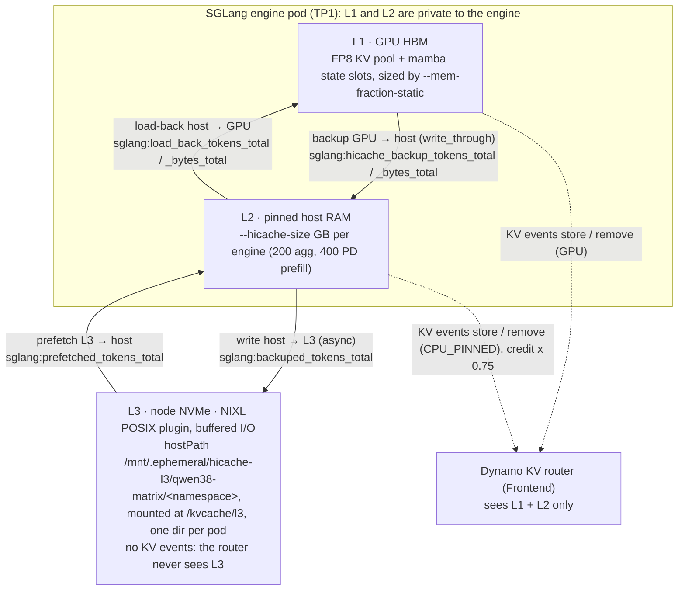

# O: KV cache offloading with SGLang HiCache

HiCache adds host RAM (L2) and local NVMe (L3) below the GPU KV pool (L1). A prefix that no longer fits in HBM gets loaded back instead of prefilled again. In the matrix this is factor **O**.

> **Status (2026-10-24).** Track Q, `Qwen/Qwen3.8-27B-FP8` at TP1 on one `p6-b200.48xlarge`. Under load O is the largest TTFT lever: in W3-16K at 25 req/s it takes the continuation TTFT p50 from 20.3 s to 0.60 s on its own. It does not fix ITL in aggregated serving, so it meets the SLO only together with R and D. W2 (n=3, pre-registered, ~100K-token contexts): O alone is inside the noise (1.02x goodput) and the pre-registered H-O failed on TTFT. Correctness first: restores of this hybrid model's KV from L2 and L3 were 16/16 on SGLang 0.5.21 (the public image) and on 0.5.22 (the build of the results), against 15/16 L3 on 0.5.18 ([Versions](#9-versions)).

| | |
|---|---|
| Engine | SGLang `HiRadixCache`: 0.5.21 in the public runtime image, 0.5.22 in the derived build of the runs of record ([Versions](#9-versions)) |
| Dynamo role | Dynamo passes the flags through unchanged and makes the router tier-aware through KV events (v1.5.1 `docs/fern/pages/developer-guide/knowledge-base/modular-components/backends/sglang/hicache.md:46,56-75`) |
| Replaces | Dynamo KVBM, which is deprecated (v1.5.1 `docs/fern/pages/reference/general/releases/known-issues.mdx:53`) |
| Cells | S2, S4 (aggregated, every engine), S6, S7 (disaggregated, prefill only) |
| Components | `manifests/track-q-qwen38/components/hicache-agg` (L2 200 GB per engine) and `components/hicache-prefill` (L2 400 GB per prefill engine) |
| Example | [`examples/02-hicache`](../../../examples/02-hicache/) (cell S2). Paired with the other techniques in [`examples/05-kv-router-hicache`](../../../examples/05-kv-router-hicache/) (S4, R+O) and [`examples/07-pd-hicache`](../../../examples/07-pd-hicache/) (S6, O+D) |
| Numbers | [`docs/results/w3-16k-cells.csv`](../../results/w3-16k-cells.csv) (W3-16K, n=1) |

Other docs: [repo README](../../../README.md) · [R: KV-aware router](../kv-router/README.md) · [O: HiCache](README.md) (this page) · [D: PD disaggregation](../pd-disaggregation/README.md) · [results](../../results/README.md) · [dashboards](../../../dashboards/README.md)

---

## 1. Tiers and data movement



| Tier | Medium | Size knob | Scope | Router | Hit label `cache_source` |
|---|---|---|---|---|---|
| L1 | GPU HBM | `--mem-fraction-static 0.85`: 2,100,224 FP8 KV tokens and 401 mamba slots per engine (E1 boot log) | per engine | yes, `store(GPU)` | `device` |
| L2 | pinned host RAM | `--hicache-size` GB per engine (overrides `--hicache-ratio`): 3,213,760 KV tokens at 200 GB (E1 boot log) | per engine | yes, `store(CPU_PINNED)`, credited at `--router-host-cache-hit-weight` 0.75 | `host` |
| L3 | node NVMe via NIXL POSIX | free space under the hostPath | per pod (`subPathExpr: $(POD_NAME)`) | no: "no separate disk tier" (v1.5.1 `router/offloading-support-matrix.md:17`) | `storage_HiCacheNixl` |

- There is no NVMe-to-GPU path (this is not GDS). L3 data always goes through L2: prefetch, then load-back.
- `--router-disk-cache-hit-weight` has no effect, because SGLang HiCache with nixl emits no disk-tier events.
- **Hybrid model.** Qwen3.8 keeps per-request mamba state next to the attention KV. `--hicache-size` is shared between the host KV pool and a host mamba-state pool, so the KV tokens per GB are lower than on a dense model (on the pre-block test, 80 GB became 42.17 GB of KV and 37.87 GB of mamba state). The write policy must be `write_through` and the layout `page_first` (or `page_first_direct`), which is what Track Q sets.
- **Measured restore latency** (E1, 48K-token prompts, derived image): cold prefill 2.21 s, GPU hit 0.56 s, L2 restore 0.57 s, L3 restore 1.60 s.

## 2. Where it runs in Track Q

| Topology (`manifests/track-q-qwen38/topologies/…`) | Namespace | Cells | HiCache on | L2 per engine | Memory request / limit |
|---|---|---|---|---|---|
| `t-agg` | `s-agg` | S0, S1 | none | none | 64Gi / 128Gi per worker |
| `t-agg-hic` | `s-agg-hic` | S2, S4 | all 8 agg workers | 200 GB (8 × 200 GB = 1.6 TB) | 200Gi / 224Gi per worker |
| `t-dis` | `s-dis` | S3, S5 | none | none | prefill 64Gi / 128Gi, decode 64Gi / 64Gi |
| `t-dis-hic` | `s-dis-hic` | S6, S7 | the 4 prefill workers only | 400 GB (4 × 400 GB = 1.6 TB) | prefill 386Gi / 410Gi, decode 64Gi / 64Gi |

- **Host budget parity.** Every O cell has the same total L2 (1.6 TB), so agg and PD O cells compare like for like. The decode workers never run HiCache.
- Both components append the same flag set to the engine core and add the L3 volume; the topology overlay sets the hostPath per namespace.

## 3. Flags and env

| Setting | Value in Track Q | Source |
|---|---|---|
| `--enable-hierarchical-cache` | set | `components/hicache-agg/patch.yaml`, `components/hicache-prefill/patch.yaml` |
| `--hicache-size` | `200` (agg), `400` (PD prefill), GB = 10^9 B per engine | same |
| `--hicache-mem-layout` / `--hicache-io-backend` | `page_first` / `kernel` | same |
| `--hicache-write-policy` | `write_through` | same |
| `--hicache-storage-backend` | `nixl` | same |
| `--hicache-storage-prefetch-policy` | `timeout` | same |
| `--engine-route clear_hicache_storage:tm` | HiCache roles only, so the reset can empty L3 before every run | same |
| `SGLANG_HICACHE_NIXL_BACKEND_PLUGIN` | `POSIX` | same |
| `SGLANG_HICACHE_NIXL_USE_DIRECT_IO` | `"0"`: buffered I/O (O_DIRECT is unsafe for L3, section 8) | same |
| `SGLANG_HICACHE_NIXL_BACKEND_STORAGE_DIR` | `/kvcache/l3` | same |
| `POD_NAME` + `subPathExpr: $(POD_NAME)` | one L3 dir per pod | base env + component |
| `--engine-route flush_cache:tm` | every engine | `base/add-worker.yaml` |

To see the rendered result offline: `kubectl kustomize manifests/track-q-qwen38/cells/S2 | grep -nE 'hicache|HICACHE|kvcache|memory:'`, or read `examples/02-hicache/diff-vs-baseline.diff`.

## 4. Sizing

### 4.1 Under write_through, L2 adds only what exceeds L1

With `write_through`, every block in L1 is also in L2 (inclusive), so unique capacity is `max(L1, L2)`:

| Policy | Unique tokens per engine | Extra over L1 alone |
|---|---|---|
| `write_through` (used here) | `max(L1, L2)` | `L2 − L1`, or 0 when L2 ≤ L1 |
| `write_back` | `L1 + L2` | `L2` |

- Sources: `tools/demo_bench/src/demo_bench/domain/kv_sizing.py:125-136` (`unique_tokens`) and Dynamo v1.5.1 `components/src/dynamo/sglang/capacity.py:185-190` ("write-back adds the disjoint host pool, write-through subtracts its device mirror").
- When L2 is too small, SGLang warns at boot: `HiCache kv host pool (<N> tokens) is smaller than the device pool (<M> tokens);L2 cache effectiveness is reduced.`

### 4.2 Track Q on one p6-b200 node

| Quantity | Per engine | Per node |
|---|---|---|
| L1 device KV (E1 boot log, M) | 2,100,224 tokens | 16.8M tokens (8 engines) |
| L2 host KV at 200 GB (E1 boot log, M) | 3,213,760 tokens | 25.7M tokens (8 agg engines; the same 1.6 TB host budget in PD) |
| L2 beyond L1 under write_through (agg, arithmetic) | ≈ 1.1M tokens | ≈ 8.9M tokens |
| W3-16K live working set (INFERRED, workload design) | | 4.0-7.7M tokens at 10 req/s; mean 18.8M, peak 24.7M at 32 req/s |

The W3 rates were chosen so that the 32 req/s working set exceeds the node's GPU KV and stays within its host L2: that is the regime where O should matter.

### 4.3 Host RAM and pod memory

| Item | Value | Where |
|---|---|---|
| Pinned host memory per HiCache engine | 200 GB (agg) or 400 GB (PD prefill) | `--hicache-size` |
| HiCache worker request / limit | 200Gi / 224Gi (agg); 386Gi / 410Gi (PD prefill); non-HiCache 64Gi / 128Gi | the two components, `base/add-worker.yaml` |
| Node | 2 TiB RAM on `p6-b200.48xlarge`; the PD prefill size was fitted to the node allocatable with the decode pods | `components/hicache-prefill/patch.yaml` |

## 5. Evidence (W3-16K, n=1)

**Labels.** W3-16K has n=1: one run per cell and rate, no noise floor, no CI. It is not pooled with W2 (100K-token contexts, 0.5 req/s, n=3, pre-registered), which holds the results of record. r50 was inconclusive and is excluded. The SLO is absolute and was fixed before any W3 data: continuation TTFT ≤ 1 s, ITL ≤ 25 ms (mean per request), cold TTFT ≤ 2 s. Every W3 number below comes from [`docs/results/w3-16k-cells.csv`](../../results/w3-16k-cells.csv); "ITL" is `itl_req_p50_ms`, the median over requests of each request's mean ITL. Tier shares are full-run engine counters (populate included); the window hit is from the client usage.

**At 25 req/s:**

| Cell | R O D | Turns in SLO | Continuation TTFT p50 | ITL p50 | Turns with ITL ≤ 25 ms | Window hit | Cached by tier: GPU / L2 / L3 (% of prompt) |
|---|---|---|---|---|---|---|---|
| S0 | - - - | 0% | 20.3 s | 61 ms | 1.3% | 20% | 22.6 / 0 / 0 |
| S2 | - O - | 2.5% | 0.60 s | 44 ms | 4.5% | 44% | 21.9 / 9.4 / 10.5 |
| S4 | R O - | 32% | 0.40 s | 28 ms | 33.9% | 54% | 22.4 / 23.6 / 4.9 |
| S6 | - O D | 21% | 2.2 s | 12 ms | 100% | 57% | 22.5 / 17.9 / 12.2 |
| S7 | R O D | 90% | 0.34 s | 13 ms | 100% | 71% | 23.2 / 39.9 / 3.0 |

- **O alone (S2 vs S0)** cuts the continuation TTFT p50 from 20.3 s to 0.60 s; S2 completes 24.2 of the 25.5 req/s offered against 21.2 for S0, and its largest prefill queue is 147 against 1,270. Its window hit is 44% (S0 20%). But only 2.5% of its turns meet the SLO, because its ITL is 44 ms.
- **O is the largest TTFT lever at 25 req/s:** each O edge of the cube (S2 vs S0, S4 vs S1, S6 vs S3) divides the continuation TTFT p50 by about 34 to 44 (x0.02-x0.03).
- **At 10 req/s** every cell meets the SLO and O alone changes nothing visible (S2 0.29 s vs S0 0.28 s). **At 32 req/s** every cell saturates, S7 included: S2 44.1 s, S4 11.7 s, S6 52.8 s. S7 is the only cell with some goodput left (12.2% of turns, TTFT p50 3.47 s over the window), and its per-minute continuation TTFT p50 rises from 1.1 s to 20.9 s across the window (`docs/results/w3-16k-per-minute.csv`).

**Source of the figures.** The data shipped with this sample is W3-16K only: [`docs/results/w3-16k-cells.csv`](../../results/w3-16k-cells.csv) and [`docs/results/w3-16k-per-minute.csv`](../../results/w3-16k-per-minute.csv), one run per cell and rate (n=1), method in [`workloads/w3-16k/METHODOLOGY.md`](../../../workloads/w3-16k/METHODOLOGY.md). The W2 figures of this guide (n=3 per cell: the runs of the plans `plan-e4` to `plan-e6` in [`plans/w2-long-context`](../../../plans/w2-long-context/), with the SLO calibrated by `plan-e3`) and its E1 figures (n=1) were measured with the derived SGLang 0.5.22 build ([Versions](#9-versions)). They, and the earlier gates the guide cites, are not in the shipped data: they are unpublished internal measurements whose per-cell data is not published, so they cannot be reproduced from this repository, and each W2 figure below without its raw values carries the marker (unpublished internal measurement).

**W2, the pre-registered contrasts (n=3, results of record).** O alone (S2 vs S0): goodput 1.02x (0.264 vs 0.260 turns/s), inside the noise. H-O (O under the KV router, S4 vs S1) failed on TTFT, ÷1.03 (unpublished internal measurement) against ÷2 pre-registered, while its hit criteria passed: +17.2 points (unpublished internal measurement), and L2 + L3 served 49% of the cached tokens (unpublished internal measurement). Across the factorial O is the largest main effect on goodput, 1.31x (unpublished internal measurement), and O × D the largest interaction, 1.27x (unpublished internal measurement). In S7, host L2 served 87% of the cached tokens (unpublished internal measurement), that is 54.5% of the prompt tokens (unpublished internal measurement), and the storage tier 0.8% of the prompt tokens (unpublished internal measurement).

**Correctness (E1, a 16-prompt restore probe, before the matrix).** On the derived 0.5.22 image, L2 and L3 restores returned identical `cached_tokens`, identical answers and identical top-1 tokens in 16/16 (|Δ logprob| 0.0). On SGLang 0.5.18 one of 16 L3 restores was dropped and recomputed.

## 6. When it helps / when it does not

**Adoption order: R -> O -> D.** O is the second step: it costs pinned host memory, node NVMe, a worker restart and a correctness check of your image on your model, but it is the step that fixes TTFT once the live working set outgrows the GPU KV. With R underneath (S4) it reaches 32% of turns in the SLO at 25 req/s; the ITL bound then needs D.

| Condition | Effect |
|---|---|
| **Working set above the GPU KV, within L2 (+ L3), under load** | Helps most. Reloading a prefix replaces recomputing it, so the prefill stays below its knee: S2 TTFT p50 0.60 s vs 20.3 s for S0 at 25 req/s. INFERRED: the gain is the recompute saved, visible in the shorter prefill queue (147 vs 1,270). |
| **ITL in aggregated serving** | Not fixed. S2 44 ms and S4 28 ms, both above the 25 ms bound, against 12-13 ms for the PD cells with O (S6, S7). INFERRED: load-backs and prefill chunks still share each GPU with the decode steps; only D separates them. |
| **Working set within the GPU KV** | No gain: every revisit already hits on the GPU (10 req/s: S2 0.29 s vs S0 0.28 s). HiCache only adds host copies and pinned memory. |
| **Round-robin on long contexts** | Little gain: L1, L2 and L3 are private to the engine or pod, and a moved turn lands where its prefix is not. W2: S2 ≈ S0 (1.02x). With R and D the prefix is found (S7: L2 serves 40% of the prompt tokens at 25 req/s). |
| **L2 ≤ L1 under write_through** | L2 mirrors L1 and adds nothing (section 4.1). |
| **Cheap prefill or no reuse** | Short prompts, short shared prefixes or unique prompts: a load-back or an L3 prefetch can cost as much as recomputing. |
| **Wrong SGLang version** | On this hybrid model 0.5.18 dropped 1 of 16 L3 restores (recomputed), and 0.5.21 corrupted restores on another hybrid model in an image gate ([Versions](#9-versions)): measure restore correctness before measuring speed. |

---

## 7. How to customise and measure

**Before applying any worker-flag change, delete the live DGD.** On one full GPU node the operator creates a new worker while the old one keeps the GPUs, and the rollout deadlocks. Frontend-only changes are safe.

### 7.1 Customise

| Goal | How |
|---|---|
| L2 size | Change `"200"` in `components/hicache-agg/patch.yaml` or `"400"` in `components/hicache-prefill/patch.yaml`, and the memory request / limit next to it (it must cover the pinned pool plus the process). Keep the totals equal across agg and PD if you compare them. Keep the L2 tokens per engine clearly above the L1 tokens (section 4.1); check that the boot warning is absent. |
| Re-render | `scripts/render-track-q.sh` and `scripts/render-examples.sh` (offline), then the manifest tests: the committed `rendered/S<n>.yaml` are drift-tested. |
| Prefetch policy | `--hicache-storage-prefetch-policy` `best_effort`, `wait_complete` or `timeout` (Track Q): when an L3 prefetch stops waiting. |
| Write policy, layout | `write_back` makes L2 disjoint (`L1 + L2`) but hybrid models need `write_through`; `--hicache-mem-layout` and `--hicache-io-backend` must change as a pair (`page_first` + `kernel`, or `page_first_direct` + `direct`). |
| L2 only | Remove the storage-backend flags, the three `SGLANG_HICACHE_NIXL_*` env, the L3 volume and mount and the `clear_hicache_storage` route from the component. The driver's reset then has no L3 to clear. |

Policy semantics are documented in SGLang's [HiCache design](https://docs.sglang.io/docs/advanced_features/hicache_design) and [best practices](https://docs.sglang.io/docs/advanced_features/hicache_best_practices). Do not set `DYN_SHARED_CACHE_TYPE` or `--shared-cache-type hicache`: they need a Mooncake shared pool (v1.5.1 `hicache.md:147,187`).

### 7.2 Metrics

| Metric | Meaning |
|---|---|
| `sglang:cached_tokens_total{cache_source}` | Hits by tier: `device` = L1, `host` = L2, `storage_HiCacheNixl` = L3. `total` is a per-request fallback, so filter `cache_source!="total"` for per-tier views. |
| `sglang:prompt_tokens_total` | Hit-rate denominator |
| `sglang:load_back_tokens_total`, `_bytes_total` | L2 → L1 |
| `sglang:backuped_tokens_total` | L2 → L3 writes, cumulative: an upper bound on L3 occupancy |
| `sglang:prefetched_tokens_total` | L3 → L2 reads |
| `sglang:hicache_host_used_tokens` / `sglang:hicache_host_total_tokens` | L2 occupancy |
| `node_disk_read_bytes_total` | NVMe reads (T-HIC-5) |
| `dynamo_component_router_kv_hit_rate_sum` / `_count` | Router predicted hit (L1 + L2 only, `kv` arm only) |

- Engine hit rate = `increase(cached)/increase(prompt)` over the replay window. Never use `sglang:cache_hit_rate`: it is a last-batch gauge.
- The L3 counters appear only when SGLang's storage metrics are on; if the L3 panels are empty, check this first.
- Dashboards: `dashboards/demo/matrix.json` row "O: HiCache tiers (L1 device, L2 host, L3 storage)", `dashboards/demo/compare.json` (HiCache tiers per arm), and `dashboards/sglang/sglang.json` row "HiCache (RAM/disk tiers)". See [dashboards/README.md](../../../dashboards/README.md).

### 7.3 Reset between runs, and the L3 caveat

- The matrix driver resets every engine before each run: `POST /engine/flush_cache` on every engine and `POST /engine/clear_hicache_storage` on the HiCache roles, then it verifies the reset with canary requests (T-RTR-2) and refuses to run if a repeat still hits.
- By hand: `kubectl --context "$KUBE_CONTEXT" -n s-agg-hic exec <worker-pod> -c main -- curl -sS -X POST -H 'Content-Type: application/json' -d '{}' http://127.0.0.1:9090/engine/clear_hicache_storage`.
- **Buffered L3.** With O_DIRECT off, L3 writes and reads go through the Linux page cache, charged to the pod's memory cgroup, so an L3 "hit" can be a DRAM read. Report L3 as the "storage tier (page cache or NVMe)" unless T-HIC-5 holds over the window, with B = KV bytes per token:

  ```
  increase(node_disk_read_bytes_total{device=~"md.*"}) ≥ 0.8 × increase(sglang:cached_tokens_total{cache_source=~"storage_.*"}) × B
  ```

## 8. Pitfalls

| Pitfall | Symptom | Fix / rule |
|---|---|---|
| **NIXL telemetry + L3 nixl** | Scheduler dies at boot: `duplicate agent name 'hicache_nixl_<uuid>'` then `RuntimeError: Failed to create telemetry exporter: prometheus` | No process with `--hicache-storage-backend nixl` may have `NIXL_TELEMETRY_ENABLE` truthy. The Track Q HiCache roles run without NIXL telemetry. |
| **O_DIRECT for L3** | Restores of misaligned pools fail or come back as zeros: on another model, whose host page was not a multiple of the 512 B block, O_DIRECT writes failed with `EINVAL`, left 0-byte L3 objects, and the restores read them back as zeroed KV | Keep `SGLANG_HICACHE_NIXL_USE_DIRECT_IO="0"` as env, as Track Q does; do not switch O_DIRECT on through `--hicache-storage-backend-extra-config` (on 0.5.18 its `use_direct_io` key was read with `bool()`, so `"false"` meant True). |
| **No flush between runs** | The previous run warms the next one | Reset and verify before every run (section 7.3). |
| L3 directories pile up | Every DGD re-create gets new pod names, so new `subPathExpr` directories | Wipe `/mnt/.ephemeral/hicache-l3/qwen38-matrix/<namespace>` only while the namespace has 0 worker pods. The matrix driver empties it when it tears a topology down (over a million files after one W2 S7 run). |
| **Host memory OOM** | `OOMKilled` | Pinned memory = `--hicache-size` per engine, outside the GPU. Raise the size only together with the memory request and limit. |
| Router blind to L3 | Router predicted hit below the engine hit | Expected: L3 emits no KV events. Report the engine hit. |
| Hybrid host pool | Fewer host KV tokens than `--hicache-size` suggests | The mamba-state host pool takes part of it. Read both from the boot log: `Allocating kv hierarchical KV host pool: <N> tokens, <X> GB host memory` and `Allocating <Y> GB host memory for hierarchical Mamba cache`. |
| Page size | 1-token KV events | Set `--page-size 64` (Track Q does). |

---

## 9. Versions

- **Runtime of the sample.** The public NGC image `nvcr.io/nvidia/ai-dynamo/sglang-runtime:1.6.0-efa@sha256:d574951b0dbd037bdcaabe121431a83cd047a5c106cb243fe6f2f97f2e456cd2` (the `RUNTIME_IMAGE` of `versions.env`): Dynamo 1.6.0, SGLang 0.5.21, NIXL 1.5.0, EFA 1.50.0. Deployed with the Dynamo operator chart 1.5.1; every component sets `runtimeVersionOverride: "1.6.0"`.
- **Runs of record (every Track Q result: W2, W3 and the demo).** Model `Qwen/Qwen3.8-27B-FP8` (revision `017b9c7a…`), TP1, 8 GPUs of one `p6-b200.48xlarge`. Every number in this guide was measured with a derived SGLang 0.5.22 build on a Dynamo 1.6.0 nightly, which is not distributed; the cells and flags are the ones of this repository, only the image differs. The workers set `DYN_FORWARDPASS_METRIC_PORT=""`: without it the derived 0.5.22 build crashed on the first decode, and the cells keep it with the public image.
- **Restore correctness: measured on 0.5.18 (15/16 L3), 0.5.21 (16/16 L2 and L3 on Qwen3.8 TP1, bs=1, RTX PRO 6000) and 0.5.22 (16/16) on L2 and L3 of Qwen3.8 TP1 on B200.** The probe sends 16 restore prompts of about 48K tokens and compares each restore with the GPU hit (`cached_tokens`, tier, top-1 token, logprobs). On 0.5.18 one L3 restore of Qwen3.8 was dropped (NIXL POSIX "requires a unique devId per file"; the prompt was recomputed: a correct answer, but a miss). In an earlier image gate a 0.5.21 build silently corrupted restored KV on another hybrid model (only 7/16 L2 and 1/16 L3 restores returned the right first code): a version that restores one model correctly can corrupt another, so measure restore correctness before speed for every new model and image.
- **Not used: the NGC image** `nvcr.io/nvidia/ai-dynamo/sglang-runtime:1.5.1` ships Dynamo 1.5.1 / SGLang 0.5.18, the version that dropped an L3 restore above.
- **Earlier functional test** (Qwen3.8 TP1 on one RTX PRO 6000, SGLang 0.5.18, n=1, no correctness check, not part of the results): with 64 × 50K-token prefixes (3.6× L1) TTFT p50 went 15.17 s → 0.96 s with L2 80 GB + L3, and back to 15.16 s with HiCache off; an L2 of 0.87× L1 gained little, 1.45× L1 most.

---

License: MIT-0, see [LICENSE](../../../LICENSE).
