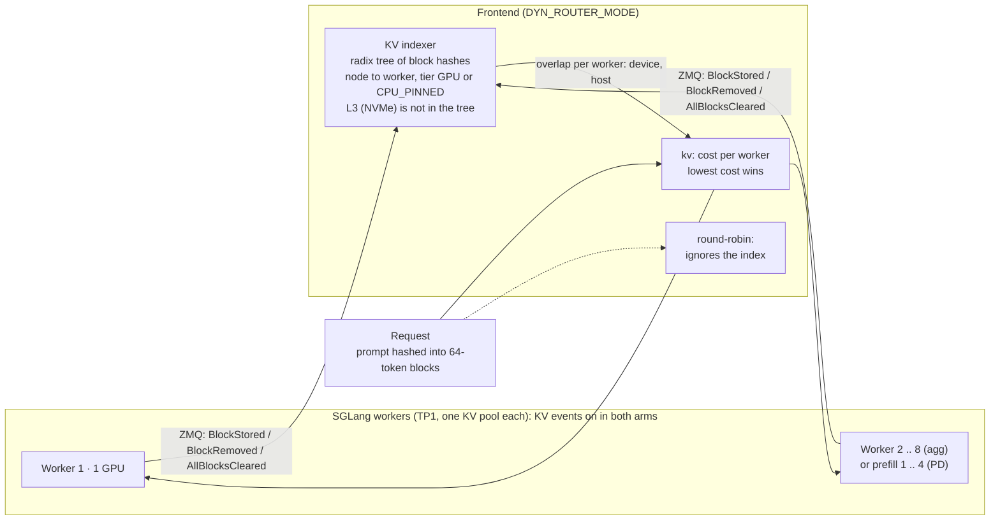

# KV-aware routing (R)

Factor **R** of the matrix: the Dynamo Frontend either spreads requests **round-robin** (R off) or sends each request to the worker that already holds the longest prefix of its prompt, weighted by load (**kv**, R on). The workers publish KV events in **both** arms. Only the Frontend's `DYN_ROUTER_MODE` changes.

> **Status (2026-10-24).** Track Q, `Qwen/Qwen3.8-27B-FP8` at TP1 on one `p6-b200.48xlarge`. On its own, R buys little under load (W2: +7% goodput, with H-R failed; W3 at 25 req/s: 0% of turns in the SLO, like the baseline). It is what turns a cache into hits once HiCache (O) keeps the prefix and PD (D) takes the decode load off the prefill workers. W2 (n=3, pre-registered, results of record): R alone gives 1.07x goodput, and the pre-registered H-R failed. W3-16K (n=1): at 25 req/s R alone stays at 0% of turns in the SLO, while R+O+D reaches 90%. The numbers are in [Evidence](#3-evidence-w3-16k-n1).

| | |
|---|---|
| Stack | Track Q: `Qwen/Qwen3.8-27B-FP8` TP1, 1x `p6-b200.48xlarge` (8x B200), public image with SGLang 0.5.21 + Dynamo 1.6.0; results measured with a derived SGLang 0.5.22 build ([Versions](#7-versions)) |
| Cells | R off: S0, S2, S3, S6. R on: S1, S4, S5, S7 (`manifests/track-q-qwen38/cells/S<n>`) |
| Toggle | `manifests/track-q-qwen38/components/router-kv`, or live with `scripts/50-toggle-router.sh <rr\|kv> <namespace>` |
| Example | [`examples/01-kv-router`](../../../examples/01-kv-router/) (cell S1): its `diff-vs-baseline.diff` is the one changed env value. Paired with the other techniques in [`examples/05-kv-router-hicache`](../../../examples/05-kv-router-hicache/) (S4, R+O) and [`examples/06-kv-router-pd`](../../../examples/06-kv-router-pd/) (S5, R+D) |
| Numbers | [`docs/results/w3-16k-cells.csv`](../../results/w3-16k-cells.csv) (W3-16K, n=1) |

Related docs: [repo README](../../../README.md) · [KV-aware routing (this page)](README.md) · [HiCache (O)](../hicache/README.md) · [PD disaggregation (D)](../pd-disaggregation/README.md) · [results](../../results/README.md) · [examples](../../../examples/README.md) · [dashboards](../../../dashboards/README.md)

Paths prefixed `v1.5.1:` are in [ai-dynamo/dynamo](https://github.com/ai-dynamo/dynamo) at tag `v1.5.1`. Read them with `git show v1.5.1:<path>`. Router docs live under `docs/fern/pages/developer-guide/knowledge-base/modular-components/router/`, shortened below to `router/`. The runtime of the runs of record is a 1.6.0 nightly: the concepts below hold, but check every flag against the `--help` of the image you run.

---

## 1. How it works



### 1.1 Building blocks

| Piece | What it does | Source |
|---|---|---|
| KV events | SGLang publishes block store/remove events only when `--kv-events-config` is set. Track Q sets it on every engine. | `v1.5.1:router/router-operations.md:138`; `manifests/track-q-qwen38/base/add-worker.yaml` |
| Event plane | ZMQ is the default event plane: each engine publishes on `tcp://*:5557`. | `v1.5.1:router/router-operations.md:131` |
| KV indexer | A global prefix (radix) tree of block hashes. Each node stores the workers holding it, so a lookup returns the matched blocks per worker. Workers keep a local indexer, so the router can recover missed events and rebuild after a restart. | `v1.5.1:router/router-design.md:152-162, 176-233` |
| Targets | One target per engine. Track Q runs TP1 without DP-attention, so the aggregated cells have **8 targets** and the PD cells **4 prefill targets** (the decode hop is load-only, below). | `manifests/track-q-qwen38/base`, `dis` |
| Block size | Track Q sets `--page-size 64`, so router blocks are 64 tokens. | `manifests/track-q-qwen38/base/add-worker.yaml` |
| Host tier | SGLang HiCache emits `BlockStored` / `BlockRemoved` with `medium` `GPU` or `CPU_PINNED`. The router credits host (L2) overlap at `--router-host-cache-hit-weight`. | `v1.5.1:.../backends/sglang/hicache.md:58-75`; `v1.5.1:router/offloading-support-matrix.md:17` |
| No L3 tier | For SGLang there is "no separate disk tier", so L3 hits (NIXL POSIX on NVMe) are invisible to the router and `--router-disk-cache-hit-weight` has no effect. | `v1.5.1:router/offloading-support-matrix.md:17` |
| Hybrid model | Qwen3.8 is a hybrid model (attention KV plus per-request mamba state, `--mamba-radix-cache-strategy extra_buffer`). The events describe attention pages; the engine can reuse a prefix only up to its last mamba checkpoint, so the router's predicted hit and the engine hit can differ in both directions (INFERRED). | `manifests/track-q-qwen38/base/add-worker.yaml` |
| No events, no cache | Without worker KV events, `kv` mode scores load only. | `v1.5.1:docs/fern/pages/kubernetes/kv-aware-routing/dynamo-frontend.md:63` |

### 1.2 Cost function (as documented at v1.5.1)

```text
# docs: v1.5.1:router/routing-concepts.md:28-36
# code: v1.5.1:lib/kv-router/src/scheduling/selector/default.rs:294-347 (worker_logit)
overlap_credit = overlap_score_credit * decay * device_blocks   # decay = 1 unless --router-kv-overlap-score-credit-decay > 0
               + host_cache_hit_weight * host_blocks            # CPU_PINNED = HiCache L2
               + disk_cache_hit_weight * disk_blocks            # always 0 with SGLang
               + shared_cache_multiplier * shared_blocks        # 0 unless --shared-cache-type is set (scheduling/config.rs:347-356)

raw_prefill    = active_prefill_blocks + incoming_prompt_blocks
cost           = prefill_load_scale * max(0, raw_prefill - overlap_credit)
               + (active_decode_blocks + incoming_active_blocks)
               + decode_active_request_weight * active_requests   # default 0, opt-in
```

- The lowest cost wins. `--router-temperature 0` (the default) is argmin. A value above 0 samples with a softmax over the normalised costs (`v1.5.1:router/routing-concepts.md:66`).
- A block held on GPU **and** host counts once, at the higher tier.
- In disaggregated serving the prefill router does the KV-aware pick among the **prefill** workers. The decode hop sets `overlap_score_credit=0`, `assume_kv_reuse=false` and `track_prefill_tokens=false`, so it routes on load only (`v1.5.1:router/disaggregated-serving.md:16-28`).

**Worked example (illustrative arithmetic, not measured).** A 640-token prompt is 10 blocks, with the defaults. It assumes active prefill is 0 on every worker and no active request shares the prefix.

| Worker | Device blocks | Host blocks | Active decode blocks | Cost |
|---|---|---|---|---|
| W1 | 8 | 0 | 12 | max(0, 10 − 8) + (12 + 10) = **24** |
| W2 | 2 | 0 | 0 | 8 + 10 = **18** |
| W3 | 4 | 4 | 2 | max(0, 10 − 4 − 0.75 × 4) + (2 + 10) = **15**, selected |
| W4 | 0 (6 blocks on L3, invisible) | 0 | 0 | 10 + 10 = **20** |

The host credit is what makes W3 win. Without it, W3 would cost 18 and tie with W2. That interaction is R × O. W1 holds the most cache but loses on decode load.

### 1.3 Why the router lets sessions move under load (INFERRED)

The cost adds a worker's active decode blocks to its prefill cost. In aggregated serving the worker that holds a session's prefix is usually also decoding other long sessions, so its decode term can outweigh the prefix credit (host blocks only earn 0.75 of a device block), and the router sends the turn to a less loaded worker that must recompute the prompt. In PD the prefill workers carry no decode load, so the prefix credit wins more often. As the request rate rises, the prefill term itself grows and the router again trades affinity for load. This reading is INFERRED from the moved-continuation shares in section 3 and from the cost function above; it was not isolated by a dedicated run (a pre-registered router re-weight variant was proposed and never ran).

---

## 2. How Track Q enables it

| File | Role |
|---|---|
| `manifests/track-q-qwen38/frontend/dgd.yaml` | The only definition of the Frontend (Frontend-only DGD `q38`): `python3 -m dynamo.frontend --http-host 0.0.0.0 --http-port 8000`, `DYN_ROUTER_MODE=round-robin` at env index 2, `runtimeVersionOverride: "1.6.0"`. The same in every topology and both arms. |
| `manifests/track-q-qwen38/components/router-kv` | R on. A JSON patch: `test` that env index 2 is named `DYN_ROUTER_MODE`, then `replace` its value with `kv`. Cells S1, S4, S5 and S7 include it. |
| `manifests/track-q-qwen38/frontends/{rr,kv}` | Frontend-only renders for the live toggle. |
| `manifests/track-q-qwen38/base/add-worker.yaml` | `--kv-events-config {"publisher":"zmq","topic":"kv-events","endpoint":"tcp://*:5557"}`, `--page-size 64` and `--engine-route flush_cache:tm` on the Worker. The PD prefill and decode roles are copies of it. |
| `scripts/50-toggle-router.sh` | Renders `manifests/track-q-qwen38/frontends/<mode>` and pipes it to one `kubectl apply --server-side --field-manager=demo-router-toggle --force-conflicts -n <ns> -f -`. |
| `tools/matrix_driver` | The matrix driver: for a `run` step on a topology that is already up it only toggles the router mode, then resets and verifies the caches before the replay. |

**Why only the Frontend rolls.** Server-side apply merges `spec.components` by name, so only the `Frontend` entry changes. The operator's worker hash excludes Frontend changes, so the worker pods and their KV caches stay up. Never merge-patch the v1beta1 `components` list, because a merge patch replaces the whole list.

### Toggle by hand

```bash
export KUBE_CONTEXT=<your-kubeconfig-context>   # required off-cluster

# Preview: the two renders differ only in DYN_ROUTER_MODE
diff <(kubectl kustomize manifests/track-q-qwen38/frontends/rr) \
     <(kubectl kustomize manifests/track-q-qwen38/frontends/kv)

scripts/50-toggle-router.sh kv s-agg   # prints elapsed_s=<n>
scripts/50-toggle-router.sh rr s-agg

# Confirm the live mode
kubectl --context "$KUBE_CONTEXT" -n s-agg get dynamographdeployment q38 \
  -o jsonpath='{.spec.components[?(@.name=="Frontend")].podTemplate.spec.containers[0].env}'
```

### Where R acts per topology

| Pair | Topology (namespace) | Targets that `kv` chooses among | What R changes |
|---|---|---|---|
| S0 → S1 | `t-agg` (`s-agg`) | 8 workers | Cache placement and load balance |
| S2 → S4 | `t-agg-hic` (`s-agg-hic`) | 8 workers, plus host-tier credit (L2) | R × O: credit for L2-resident prefixes |
| S3 → S5 | `t-dis` (`s-dis`) | 4 prefill workers (the decode hop is load-only) | Prefill-worker selection |
| S6 → S7 | `t-dis-hic` (`s-dis-hic`) | 4 prefill workers with HiCache | R × O × D |

---

## 3. Evidence (W3-16K, n=1)

**Labels.** W3-16K has n=1: one run per cell and rate, no noise floor, no CI. It is not pooled with W2 (100K-token contexts, 0.5 req/s, n=3, pre-registered), which holds the results of record. r50 was inconclusive and is excluded. The SLO is absolute and was fixed before any W3 data: continuation TTFT ≤ 1 s, ITL ≤ 25 ms (mean per request), cold TTFT ≤ 2 s. Every W3 number below comes from [`docs/results/w3-16k-cells.csv`](../../results/w3-16k-cells.csv). "ITL" is the per-request mean ITL, median over requests (`itl_req_p50_ms`). The workload is 11-turn agentic sessions with at most 16K tokens of context ([`workloads/w3-16k`](../../../workloads/w3-16k/README.md)).

**At 25 req/s** (window, turns in SLO = attainment):

| Cell | R O D | Turns in SLO | Continuation TTFT p50 / p90 | ITL p50 | Window hit | Continuations moved |
|---|---|---|---|---|---|---|
| S0 | - - - | 0% | 20.3 s / 66.5 s | 61 ms | 20% | 87% |
| S1 | R - - | 0% | 17.5 s / 52.4 s | 59 ms | 24% | 59% |
| S2 | - O - | 2.5% | 0.60 s / 5.4 s | 44 ms | 44% | 87% |
| S4 | R O - | 32% | 0.40 s / 0.90 s | 28 ms | 54% | 67% |
| S6 | - O D | 21% | 2.23 s / 11.9 s | 12 ms | 57% | 75% |
| S7 | R O D | 90% | 0.34 s / 1.00 s | 13 ms | 71% | 39% |

S3 (D alone) and S5 are discussed in the [PD guide](../pd-disaggregation/README.md); S5 did not run at 25 req/s (failed reset check).

**Moved continuations by rate (S7, R+O+D).** 5% at 10 req/s, 39% at 25 req/s and 48% at 32 req/s; the window hit falls with it, 85% → 71% → 65%. Round-robin moves about 87% on 8 workers (S0 at 25 req/s), close to the 7/8 chance.

**Other rates.** At 10 req/s every cell meets the SLO (97-100% of turns), so goodput does not separate them; R is the largest TTFT effect there: S5 (R+D) follow-ups at 0.09 s with 6.9% moved, against S3 (D, round-robin) at 0.30 s with 75.1% moved. At 32 req/s every finished cell is saturated and only S7 keeps any goodput (12.2% of turns, TTFT p50 3.47 s); S1 at 85.5 s is close to S0 at 94.5 s.

**Source of the figures.** The data shipped with this sample is W3-16K only: [`docs/results/w3-16k-cells.csv`](../../results/w3-16k-cells.csv) and [`docs/results/w3-16k-per-minute.csv`](../../results/w3-16k-per-minute.csv), one run per cell and rate (n=1), method in [`workloads/w3-16k/METHODOLOGY.md`](../../../workloads/w3-16k/METHODOLOGY.md). The W2 figures of this guide (n=3 per cell: the runs of the plans `plan-e4` to `plan-e6` in [`plans/w2-long-context`](../../../plans/w2-long-context/), with the SLO calibrated by `plan-e3`) and its E1 figures (n=1) were measured with the derived SGLang 0.5.22 build ([Versions](#7-versions)). They, and the earlier gates the guide cites, are not in the shipped data: they are unpublished internal measurements whose per-cell data is not published, so they cannot be reproduced from this repository, and each W2 and E1 figure below without its raw values carries the marker (unpublished internal measurement).

**W2, the pre-registered contrast (n=3, results of record).** S1 vs S0 goodput 1.07x (0.279 vs 0.260 turns/s). H-R failed: GPU hit +6.4 points (unpublished internal measurement) against the ≥ 15 points pre-registered (+27 predicted). Continuations moved off their worker: S0 85.9%, S1 78.7%, S4 65.9%, S7 12.0%, and S5 72.5% (unpublished internal measurements): PD without HiCache is not sticky either. Across the factorial R is worth 1.02x without O and 1.28x with it (unpublished internal measurements).

**Light-load functional check (E1, n=1).** On 8 TP1 workers with HiCache, 10 sessions of 4 turns (32K-token contexts, later turns sent one at a time): `kv` kept 10/10 sessions on their worker, with revisit hits 30/30 (94% of the tokens) and revisit TTFT p50 0.102 s, against 0/30 and 1.27 s under round-robin (unpublished internal measurements). The router's predicted hit equalled the engine hit in 40/40 requests (unpublished internal measurement). Light load is where stickiness is easy; W3 shows what happens when the load rises.

**Router predicted vs engine hit under HiCache.** On W2 S7 continuations the router predicted 66.8% against an engine hit of 87.6% (unpublished internal measurements): L3 is invisible to the router, and a constant under-read of about 23.3K tokens (unpublished internal measurement) remains whose cause was not identified (INFERRED).

## 4. When it helps / when it does not

**Adoption order: R -> O -> D.** R is the cheapest step: one Frontend env value, no worker restart, the KV caches stay warm. Adopt it first, but expect little from it alone under load; it pays once O keeps the prefixes and D frees the prefill workers.

| Helps | Does not help (or cannot be seen) |
|---|---|
| **With O and D underneath.** Adding R to O+D (S6 → S7) at 25 req/s takes turns in the SLO from 21% to 90% and continuation TTFT p50 from 2.23 s to 0.34 s. Adding R to O alone (S2 → S4) takes them from 2.5% to 32% and 0.60 s to 0.40 s. | **R alone on aggregated workers under load.** S1 ≈ S0 at 25 req/s: 0% of turns in the SLO for both, TTFT p50 17.5 s vs 20.3 s, ITL 59 vs 61 ms. The prefill is saturated and the GPU KV cannot keep the sessions; routing does not add capacity. |
| **Low load, working set within the GPU KV of the targets.** At 10 req/s R gives the fastest follow-ups even without O (S5 0.09 s vs S3 0.30 s). INFERRED: the live working set at 10 req/s fits the KV of the 4 prefill GPUs. | **Rising load.** The router trades affinity for load: S7 moves 5% → 39% → 48% of continuations at 10/25/32 req/s and its hit falls 85% → 71% → 65% (mechanism INFERRED, section 1.3). |
| **Many targets and real reuse:** agentic sessions, shared system prompts, multi-turn loops. Track Q has 8 targets in agg and 4 in PD. | **Long contexts without O** (W2, ~100K tokens): without host-tier blocks the prefix credit is small next to the load term, so S5 moves 72.5% of continuations (unpublished internal measurement), like round-robin. |
| **Host tier visible:** L2 blocks earn 0.75 credit (S4, S7). | **L3 hits** are invisible, so the router predicted hit understates the engine hit. One target only: nothing to choose. Workers without KV events, or `cache_salt` set (section 6): `kv` falls back to load only. |

**Design rule (INFERRED).** R helps when the distinct prefix working set is **larger than one target's** KV pool but **fits the sum** of all targets' pools (plus their host tier with O). KV routing deduplicates the cache across targets, up to N× effective capacity for N targets; round-robin copies every hot prefix onto every target.

---

## 5. Parameters you can customise

### 5.1 Router knobs (Frontend)

None of these is set in Track Q, so the defaults apply. Flag and env names are from `v1.5.1:docs/fern/pages/reference/components/frontend-configuration.mdx` (line numbers given); confirm them against the `--help` of your image.

| Flag | Env | Default | Notes for this sample |
|---|---|---|---|
| `--router-mode` (:73) | `DYN_ROUTER_MODE` | `round-robin` | **The R toggle.** Also `random`, `power-of-two`, `kv`, `direct`, `least-loaded`, `device-aware-weighted`. |
| `--router-kv-overlap-score-credit` (:111) | `DYN_ROUTER_KV_OVERLAP_SCORE_CREDIT` | `1.0` | The primary cache-reuse knob. Higher values give more locality and lower TTFT; lower values give more spread and lower ITL (`router/configuration-and-tuning.md:431`). `0` creates no indexer at all (`router/router-operations.md:133`). The candidate for the untested re-weight variant of section 1.3. |
| `--router-kv-overlap-score-credit-decay` (:119) | `DYN_ROUTER_KV_OVERLAP_SCORE_CREDIT_DECAY` | `0.0` | Shrinks device credit on cache-rich but busy workers. `1` halves it at one request-equivalent of excess prefill (`:433`). |
| `--router-prefill-load-scale` (:127) | `DYN_ROUTER_PREFILL_LOAD_SCALE` | `1.0` | Weight of the prompt-side load against decode blocks. |
| `--router-host-cache-hit-weight` (:134) | `DYN_ROUTER_HOST_CACHE_HIT_WEIGHT` | `0.75` | Credit for HiCache L2 (`CPU_PINNED`) blocks. It matters only in S4 and S7. |
| `--router-disk-cache-hit-weight` (:140) | `DYN_ROUTER_DISK_CACHE_HIT_WEIGHT` | `0.25` | **No effect here.** SGLang has no router-visible disk tier. |
| `--router-temperature` (:160) | `DYN_ROUTER_TEMPERATURE` | `0.0` | Above 0, softmax sampling adds randomness to the spread. |
| `--router-kv-events` / `--no-router-kv-events` (:169) | `DYN_ROUTER_USE_KV_EVENTS` | `true` | Keep it on. Off means the router predicts cache state from its own routing decisions (`--router-ttl-secs`). |
| `--router-predicted-ttl-secs` (:182) | `DYN_ROUTER_PREDICTED_TTL_SECS` | unset | A side indexer for bursts of sibling requests that arrive before the first `BlockStored` event (`:451`). Do not combine it with `--no-router-kv-events`. |
| `--router-event-threads` (:189) | `DYN_ROUTER_EVENT_THREADS` | `4` | Indexer threads. A value above 1 uses the concurrent radix tree. |
| `--router-track-active-blocks` (:239) | `DYN_ROUTER_TRACK_ACTIVE_BLOCKS` | `true` | Decode-load term. |
| `--router-assume-kv-reuse` (:245) | `DYN_ROUTER_ASSUME_KV_REUSE` | `true` | The PD decode hop already turns it off (`router/disaggregated-serving.md:27`). |
| `--router-track-output-blocks` (:251) | `DYN_ROUTER_TRACK_OUTPUT_BLOCKS` | `false` | For output-heavy loads. |
| `--router-decode-active-request-weight` (:258) | `DYN_ROUTER_DECODE_ACTIVE_REQUEST_WEIGHT` | `0.0` | Experimental per-request decode cost. It can regress on memory-bound decode (`:445`). |
| `--router-queue-threshold` (:281) | `DYN_ROUTER_QUEUE_THRESHOLD` | unset | See `router/configuration-and-tuning.md:465-470` before setting it. |
| `--load-aware` (:105) | `DYN_ROUTER_LOAD_AWARE` | `false` | A load-only `kv` preset with no cache signals: a useful extra control arm to separate R's load-balancing share from its cache share. Not part of the matrix. |
| `--shared-cache-type` (:152) | `DYN_SHARED_CACHE_TYPE` | `none` | **Do not set it.** It is for a Mooncake shared pool only. |

**How to set one, for both arms and every cell.** Edit the Frontend in `manifests/track-q-qwen38/frontend/dgd.yaml`, then re-render Track Q (`scripts/render-track-q.sh`) and the examples (`scripts/render-examples.sh`):

- **CLI flag (recommended).** Append it to `args`. `scripts/preflight-flags.sh` then validates it against the image's `--help`.
- **Env var.** Append it **after** `DYN_ROUTER_MODE`. `components/router-kv` tests env index 2, so inserting anything before it breaks the render. Env names are not validated by preflight.

```bash
# 1. Validate offline: capture the Frontend --help of the image you run (RUNTIME_IMAGE of
#    manifests/config/platform.env), CPU only
docker run --rm <RUNTIME_IMAGE> python3 -m dynamo.frontend --help > frontend.help.txt
scripts/preflight-flags.sh --help-file frontend=frontend.help.txt \
  manifests/track-q-qwen38/frontends/rr manifests/track-q-qwen38/frontends/kv

# 2. Apply onto the live DGD: only the Frontend rolls
scripts/50-toggle-router.sh kv s-agg
```

Keep router settings on the **Frontend only**. A worker set that advertises its own router config replaces the Frontend's for that set and does not merge with it (`v1.5.1:router/configuration-and-tuning.md:16-22`).

### 5.2 Worker-side knobs

| Knob | Where | Notes |
|---|---|---|
| `--kv-events-config` | `manifests/track-q-qwen38/base/add-worker.yaml` | Required for real `kv` routing. Keep it on in **both** arms so the two arms differ only in the Frontend. |
| `--page-size 64` | same file | Set explicitly. The CUDA default of 1 gives 1-token events and a useless comparison. |
| Engines per node | 8 TP1 workers (agg) or 4P4D (PD) | Each engine is one target. More, smaller engines give the router more choice and each a smaller KV pool. |

### 5.3 Workload knobs

| Knob | How | Notes |
|---|---|---|
| W3-16K trace | `workloads/w3-16k/regen.sh <rate> <out-dir>` | Regenerates the exact window trace of 10, 25, 32 or 50 req/s offline. |
| Plans | `plans/w3-16k/plan-w3-r<rate>.txt` (S0, S7) and `plan-w3-r<rate>-cells.txt` (S1 to S6) | Run in-cluster by `tools/matrix_driver` (launch sequence in its README). |
| Your own sessions | `demo-bench trace w2 --sessions <N> --rate <r> ...` | The generator behind W2 and W3 (`tools/demo_bench`). |

---

## 6. How to measure, and pitfalls

### 6.1 Metrics

| Signal | Metric | Notes |
|---|---|---|
| Engine hit (number of record) | `increase(sglang:cached_tokens_total)` / `increase(sglang:prompt_tokens_total)` over the replay window | Never use `sglang:cache_hit_rate`, which is a last-batch gauge. |
| Router predicted hit | `dynamo_component_router_kv_hit_rate_sum` / `_count` | Observed only in `kv`. 0/0 is reported as `null`, not 0. |
| Events flowing | `dynamo_component_kv_cache_events_applied{event_type="stored",status="ok"}` | Watch `status!="ok"` too. |
| Load spread | `sglang:num_running_reqs`, `sglang:num_queue_reqs` by pod; in `kv` also `dynamo_frontend_worker_active_decode_blocks`, `dynamo_frontend_worker_active_prefill_tokens` | |
| Session stickiness | the worker per request: the driver asks for `"nvext": {"extra_fields": ["worker_id", "timing"]}` and the analysis compares each continuation's (prefill) worker with its previous turn's | This is the `moved_share` column of the results. |
| Latency | `dynamo_frontend_time_to_first_token_seconds_bucket`, `sglang:inter_token_latency_seconds_bucket` | |

Dashboards: `dashboards/demo/matrix.json` (uid `dynamo-eks-demo-matrix`), row **R**, with the `namespace` variable set to the cell's namespace; `dashboards/demo/compare.json` for baseline vs optimized. The panels illustrate; the tables are the numbers of record ([dashboards/README.md](../../../dashboards/README.md)).

```bash
kubectl --context "$KUBE_CONTEXT" -n s-agg port-forward svc/q38-frontend 8000:8000 &
curl -s localhost:8000/metrics | grep -E 'kv_cache_events_applied|router_kv_hit_rate_(sum|count)'
```

### 6.2 Pitfalls

| Pitfall | Consequence | Do this |
|---|---|---|
| `cache_salt` in requests, or an `x-tenant-id` header (it maps to `cache_salt`, `v1.5.1:.../nvidia-request-extensions-nvext.md:69`) | Salted router hashes never match unsalted events, so `kv` silently becomes load-only (same file, `:98`). | Send no salt. Isolate runs with a cache flush and a verified reset (the driver does both). |
| Workers without `--kv-events-config` | `kv` scores load only. Events-applied stays flat. | Keep it on every engine in both arms. |
| Reading the router predicted hit as the real hit with HiCache | L3 hits are invisible, so the prediction understates the engine hit | Report the engine hit from `sglang:cached_tokens_total`. |
| Inserting a Frontend env var before `DYN_ROUTER_MODE` | The `test` op on env index 2 fails and the render breaks | Append after it, or use CLI args. |
| Router flags on workers | A worker set's advertised router config replaces the Frontend's, without merging | Router settings belong on the Frontend only. |
| Merge-patching `spec.components` | It replaces the list and drops the workers | Use server-side apply (the toggle script). |
| Toggling after warming prefixes in `rr` | Old prefixes are already on every worker, so `kv` looks no better | Flush the caches between arms, or send **fresh** sessions. |
| Re-applying edited **worker** flags on a full GPU node | The operator's rolling update deadlocks: the old pods keep the GPUs | Delete the DGD first. Frontend-only changes are safe. |
| Expecting the disk weight to act | SGLang has no disk tier for the router | Tune `--router-host-cache-hit-weight` only. |

---

## 7. Versions

- **Runtime of the sample.** The public NGC image `nvcr.io/nvidia/ai-dynamo/sglang-runtime:1.6.0-efa@sha256:d574951b0dbd037bdcaabe121431a83cd047a5c106cb243fe6f2f97f2e456cd2` (the `RUNTIME_IMAGE` of `versions.env`): Dynamo 1.6.0, SGLang 0.5.21, NIXL 1.5.0, EFA 1.50.0. Deployed with the Dynamo operator chart 1.5.1; every component sets `runtimeVersionOverride: "1.6.0"` so the 1.5.1 operator runs the 1.6.0 runtime.
- **Runs of record (every Track Q result: W2, W3 and the demo).** Model `Qwen/Qwen3.8-27B-FP8` (revision `017b9c7a…`), TP1, 8 GPUs of one `p6-b200.48xlarge`. Every number in this guide was measured with a derived SGLang 0.5.22 build on a Dynamo 1.6.0 nightly, which is not distributed; the cells and flags are the ones of this repository, only the image differs. The workers set `DYN_FORWARDPASS_METRIC_PORT=""`: without it the derived 0.5.22 build crashed on the first decode, and the cells keep it with the public image.
- **Restore correctness: measured on 0.5.18 (15/16 L3), 0.5.21 (16/16 L2 and L3 on Qwen3.8 TP1, bs=1, RTX PRO 6000) and 0.5.22 (16/16) on L2 and L3 of Qwen3.8 TP1 on B200.** On 0.5.18 one L3 restore was dropped (NIXL POSIX "requires a unique devId per file"; the prefetch was dropped and the prompt recomputed: a correct answer, but a miss). In an earlier image gate a 0.5.21 build silently corrupted restored KV on another hybrid model (only 7/16 L2 and 1/16 L3 restores returned the right first code): measure restore correctness before speed for every new model and image.
- **Not used: the NGC image** `nvcr.io/nvidia/ai-dynamo/sglang-runtime:1.5.1` ships Dynamo 1.5.1 / SGLang 0.5.18, the version that dropped an L3 restore above.
- **Earlier functional test** (Qwen3.8 on one RTX PRO 6000, one TP1 worker, n=1, not part of the results): with HiCache L2 + L3 the router predicted 29.0% against an engine hit of 78.1%, because L3 served 49% of the cached tokens and the router cannot see L3.
- The `v1.5.1:` paths above are documentation and source at the Dynamo tag; the router flags were not re-checked line by line against the 1.6.0 nightly.

---

License: MIT-0, see [LICENSE](../../../LICENSE).
