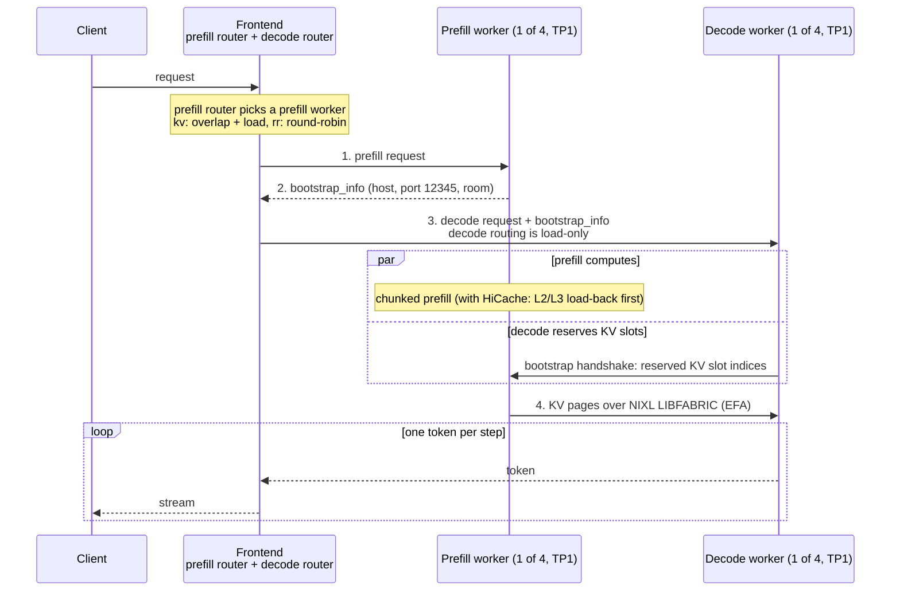
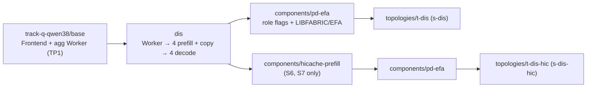

# D: Prefill/decode disaggregation

> **Status (2026-10-24).** Track Q, `Qwen/Qwen3.8-27B-FP8` at TP1, 4 prefill + 4 decode workers (4P4D) over NIXL LIBFABRIC on EFA, on one `p6-b200.48xlarge`. D is the only factor that holds the ITL bound under load: every PD cell keeps the ITL at 10-13 ms at 25 req/s where the aggregated cells are at 28-61 ms. On its own it costs goodput, because 4 GPUs must prefill what 8 did. On top of the KV router (R) and HiCache (O) it makes the best cell (S7). W2 (n=3, pre-registered): D alone 0.75x goodput, R+O+D 1.46x, and H-D failed as predicted. W3-16K (n=1): at 25 req/s S3 (D alone) is the worst cell and S7 the only one near the SLO. The numbers are in [Evidence](#5-evidence-w3-16k-n1).

[Repo README](../../../README.md) · [R: KV router](../kv-router/README.md) · [O: HiCache](../hicache/README.md) · **D: PD disaggregation** · [results](../../results/README.md) · [examples](../../../examples/README.md)

Citation convention: `v1.5.1 <path>` means the NVIDIA Dynamo tag v1.5.1 (`2093662a`). The runtime of the runs of record is a 1.6.0 nightly; the flow below is as documented at that tag.

- Code paths (`components/`, `lib/`, `examples/`) are relative to that repo's root.
- Doc paths are relative to `docs/fern/pages/`:
  - `router/`, `backends/` and `concepts/` live under `developer-guide/knowledge-base/` (`router/` and `backends/` inside `modular-components/`);
  - `efa-on-aws.mdx` lives under `kubernetes/installation/rdma-setup/`.
- Paths without a prefix are in this repo.

| | |
|---|---|
| Factor | **D**: aggregated workers vs separate prefill and decode workers |
| Cells | S3 (rr, O off), S5 (kv, O off), S6 (rr, O on), S7 (kv, O on) |
| Topologies | `t-dis` (namespace `s-dis`), `t-dis-hic` (namespace `s-dis-hic`) under `manifests/track-q-qwen38/topologies` |
| Shape | 4 prefill pods + 4 decode pods, TP1, one GPU and one EFA interface each, on one `p6-b200.48xlarge` |
| Transport | NIXL `LIBFABRIC` over EFA, prefill and decode in separate pods |
| Examples | [`examples/03-pd-disaggregation`](../../../examples/03-pd-disaggregation/) (S3) and [`examples/04-all-three`](../../../examples/04-all-three/) (S7). Paired with the other techniques in [`examples/06-kv-router-pd`](../../../examples/06-kv-router-pd/) (S5, R+D) and [`examples/07-pd-hicache`](../../../examples/07-pd-hicache/) (S6, O+D) |
| Claim under test | PD trades TTFT for a steadier ITL. It is **not** expected to give more throughput (a design assumption) |

---

## 1. Why

- **Prefill** processes the whole prompt in parallel and is **compute-bound**. **Decode** produces one token per step and is **memory-bound**.
- In an aggregated worker both share the same GPU. SGLang runs prefill batches (and, with HiCache, load-backs) between decode batches, so a long prompt's prefill delays the decode steps of the requests already streaming. Under load the ITL of every stream rises.
- PD moves prefill onto its own GPUs, so the decode GPUs run only decode steps.
- The cost:
  - an extra hop and a KV transfer before the first token;
  - capacity split into two fixed pools: the prefill pool's KV cache is not used during decode (v1.5.1 `concepts/system-architecture/disaggregated-serving.md:117-126`), and here only 4 GPUs prefill.
- Dynamo's own guide says that disaggregation "is not automatically better" (v1.5.1 `kubernetes/disaggregated-serving/overview.md:68-71`). This repo reports D as a **measured trade-off**: goodput under declared SLOs, with the TTFT cost shown.

## 2. How it works in Dynamo + SGLang



The flow is **prefill-first**:

- **Prefill router.** The Frontend creates an internal prefill router once typed prefill and decode workers register (v1.5.1 `router/disaggregated-serving.md:14-23`). The prefill hop inherits the Frontend's `DYN_ROUTER_MODE` unless the prefill worker advertises its own router config (v1.5.1 `lib/llm/src/kv_router/prefill_router/activation.rs:53-65`). Track Q's workers advertise none, so the R toggle governs the prefill hop.
- **Bootstrap.** The SGLang prefill handler returns `bootstrap_info` `{bootstrap_host, bootstrap_port, bootstrap_room}` (v1.5.1 `components/src/dynamo/sglang/request_handlers/llm/prefill_handler.py:74-210`); the decode handler refuses to run without it (`decode_handler.py:517-551`). The port is `--disaggregation-bootstrap-port 12345` on both roles (`manifests/track-q-qwen38/components/pd-efa/patch.yaml`).
- **KV transfer.** NIXL moves KV from prefill VRAM to decode VRAM without blocking forward passes (v1.5.1 `concepts/system-architecture/disaggregated-serving.md:16-18`). Track Q selects the LIBFABRIC backend (`SGLANG_DISAGGREGATION_NIXL_BACKEND=LIBFABRIC`).
- **Decode routing.** In PD mode, decode routing turns off overlap scoring, the KV-reuse assumption and prefill-token tracking (v1.5.1 `router/disaggregated-serving.md:25-28`). R therefore chooses among the 4 prefill workers (see the [KV router doc](../kv-router/README.md)).
- **No silent fallback.** Once a request is dispatched to prefill, a prefill failure is returned to the client; it is never retried as aggregated (`:23`). The Frontend flag `--decode-fallback` stays at its default, `false` (v1.5.1 `reference/components/frontend-configuration.mdx:97-100`).
- **HiCache** runs on the prefill only (S6, S7); the decode workers never run it.

## 3. On one p6-b200 node

### 3.1 Transport: NIXL LIBFABRIC over EFA, cross-pod

On one node, the cross-pod prefill-to-decode path was the open question: NVIDIA's measured multi-pod B200 disaggregated recipes move KV over InfiniBand, which p6-b200 does not have. An earlier transport gate (Qwen3-32B-FP8, 1 prefill + 1 decode, TP1) tried five variants, and only **NIXL LIBFABRIC over EFA** passed as a cross-pod transport (20/20 requests, LIBFABRIC instantiated, 0 failed transfers, about 48 GB/s lower bound). UCX on default pods, UCX with `hostIPC` and Mooncake over NVLink failed; both roles in one pod over UCX worked but showed no `cuda_ipc` evidence. The runs of record use LIBFABRIC for every PD cell.

What the runs of record measured on Track Q:

- **E1 functional gate (n=1):** NIXL KV transfer at 33-37 GB/s (a lower bound), eth0 carried < 0.5% of the bytes, all 8 processes ran LIBFABRIC, 0 errors. At batch size 1 TTFT and ITL equal the aggregated values, because the transfer overlaps the prefill, and the top-1 tokens are identical to agg in 16/16.
- **W2 factorial (n=3):** 11,040 KV transfers over the 12 PD runs, 0 failed, LIBFABRIC instantiated on every PD pod, eth0 ≤ 0.065% of the KV bytes.

The matrix driver refuses a PD run unless every engine's boot log shows `Backend LIBFABRIC was instantiated` (or `KVManager initialized with backend: LIBFABRIC`). Track Q does not enable NIXL telemetry; the transfer evidence of record is SGLang's own `sglang:kv_transfer_*` and `sglang:num_transfer_failed_reqs_total` per engine plus the eth0 delta (the EFA byte counters were not readable on that node).

### 3.2 Repo pieces



| Path | What it does |
|---|---|
| `manifests/track-q-qwen38/dis/pd-roles.yaml` | Copies the agg `Worker` into `prefill` (4 replicas) and `decode` (4 replicas), 1 GPU each. Both keep the Worker's engine core, env, probes and placement. Decode memory 64Gi / 64Gi. |
| `manifests/track-q-qwen38/components/pd-efa/patch.yaml` | On both roles: `--disaggregation-mode prefill\|decode`, `--disaggregation-transfer-backend nixl`, `--disaggregation-bootstrap-port 12345`; `SGLANG_DISAGGREGATION_NIXL_BACKEND=LIBFABRIC`, `FI_PROVIDER=efa`, `FI_EFA_USE_DEVICE_RDMA=1`, `FI_EFA_ENABLE_SHM_TRANSFER=0`, `FI_EFA_ENABLE_SHM=0`, an explicit `LD_LIBRARY_PATH` (EFA libraries first; Kubernetes does not expand `${...}`); `vpc.amazonaws.com/efa: 1` request = limit; `privileged: true`; a GPU-pin wrapper. |
| GPU-pin wrapper (same file) | A privileged container sees every GPU of the node, so CUDA would pick GPU 0, another pod's. The wrapper pins `CUDA_VISIBLE_DEVICES` to the GPU the device plugin allocated (`EXPECTED_GPUS=1`) and exits if it cannot. |
| `manifests/track-q-qwen38/components/hicache-prefill` | S6/S7: L2 400 GB + L3 on each prefill engine (4 × 400 GB = the 1.6 TB of the agg O cells). |
| `manifests/track-q-qwen38/cells/S3`, `S5`, `S6`, `S7` | Topology + router mode; committed renders in `manifests/track-q-qwen38/rendered/`. |

### 3.3 Pod placement and memory

| Topology | Pods (GPUs) | Memory request / limit |
|---|---|---|
| `t-dis` | 4 prefill (1 each) + 4 decode (1 each) | prefill 64Gi / 128Gi, decode 64Gi / 64Gi |
| `t-dis-hic` | 4 prefill with HiCache + 4 decode | prefill 386Gi / 410Gi, decode 64Gi / 64Gi |

The decode KV capacity is 2,100,224 tokens per engine (the same engine core as the aggregated worker), 8.4M across the 4 decode GPUs.

## 4. Run it

Prerequisites: the cluster and the Track Q config (`manifests/config/platform.env`), the scenario namespaces, and `export KUBE_CONTEXT=<your-context>`. Only one 8-GPU topology fits on the node at a time: delete the DGD of the other namespaces first.

```bash
# Offline: what D changes against the baseline
less examples/03-pd-disaggregation/diff-vs-baseline.diff

# Deploy one cell (S3 = PD without HiCache, round-robin; S7 = all three)
kubectl --context "$KUBE_CONTEXT" apply --server-side -k examples/03-pd-disaggregation

# Transport check: every engine must have instantiated LIBFABRIC
kubectl --context "$KUBE_CONTEXT" -n s-dis logs -l nvidia.com/dynamo-component-type=prefill -c main --tail=-1 \
  | grep -E "Backend LIBFABRIC was instantiated|KVManager initialized with backend: LIBFABRIC"
```

- **Recorded runs.** The matrix driver (`tools/matrix_driver`, plans in `plans/w3-16k/`) deploys a cell, waits for the 4 + 4 workers, resets and verifies the caches, replays the frozen trace and records `kv_transfer_*`, eth0 and the per-request prefill/decode worker ids. Its preflight expects exactly 4 prefill and 4 decode pods.

## 5. Evidence (W3-16K, n=1)

**Labels.** W3-16K has n=1: one run per cell and rate, no noise floor, no CI. It is not pooled with W2 (100K-token contexts, 0.5 req/s, n=3, pre-registered), which holds the results of record. r50 was inconclusive and is excluded. The SLO is absolute and was fixed before any W3 data: continuation TTFT ≤ 1 s, ITL ≤ 25 ms (mean per request), cold TTFT ≤ 2 s. Every W3 number below comes from [`docs/results/w3-16k-cells.csv`](../../results/w3-16k-cells.csv); "ITL" is `itl_req_p50_ms`, the median over requests of each request's mean ITL.

**At 25 req/s** (S4 is the best aggregated cell, for comparison):

| Cell | R O D | Turns in SLO | Continuation TTFT p50 | ITL p50 | Turns with ITL ≤ 25 ms | Completed of 25.5 req/s | Largest prefill queue | Decode KV peak |
|---|---|---|---|---|---|---|---|---|
| S0 | - - - | 0% | 20.3 s | 61 ms | 1.3% | 21.2 | 1,270 | n/a |
| S4 | R O - | 32% | 0.40 s | 28 ms | 33.9% | 24.3 | 7 | n/a |
| S3 | - - D | 0% | 84.3 s | 10 ms | 100% | 17.5 | 613 | 0.96 |
| S6 | - O D | 21% | 2.2 s | 12 ms | 100% | 24.5 | 315 | 0.94 |
| S7 | R O D | 90% | 0.34 s | 13 ms | 100% | 25.3 | 15 | 0.36 |

- **D holds the ITL.** Every PD cell keeps 100% of its turns within the 25 ms ITL bound; the aggregated cells reach 1.3% to 33.9%.
- **D alone is the worst cell.** S3: continuation TTFT p50 84.3 s against 20.3 s for S0, only 17.5 of the 25.5 req/s completed, a prefill queue of up to 613. Four prefill GPUs recompute every continuation that eight aggregated GPUs used to share.
- **D on top of R+O is the best cell.** S4 → S7: 32% → 90% of turns in the SLO, TTFT p50 0.40 → 0.34 s, ITL 28 → 13 ms.
- **At 32 req/s** every finished cell saturates, S7 included. S7 is the only cell with some goodput left (12.2% of turns, TTFT p50 3.47 s over the window, ITL 14.5 ms), but its per-minute continuation TTFT p50 rises from 1.1 s to 20.9 s across the window (`docs/results/w3-16k-per-minute.csv`) and its decode KV peaks at 0.96 of capacity; S6 is saturated (TTFT p50 52.8 s) with the ITL still at 11.9 ms. **At 10 req/s** every cell meets the SLO; S3 is the lowest at 97.0%.
- **Failures, stated:** S5 at 25 req/s failed the pre-load reset check (T-RTR-2, `repeat_cached_zero`: the engines counted 2,048 cached tokens on the post-flush repeat while the clients reported 0), so no load ran and S5 has no 25 req/s row. At r32 the S3 and S5 decode workers crashed after the replay started (the decode pods restarted with last-terminated reason Error, not OOMKilled, per the Prometheus history), and the cause is undetermined; at r25 S3 ran clean with its decode KV at 0.96, and at r32 S6 and S7 also reached 0.96 without restarts, so a full decode KV alone does not explain the crash (INFERRED). Both failures hit PD without HiCache. Details: [docs/results](../../results/README.md).

**Source of the figures.** The data shipped with this sample is W3-16K only: [`docs/results/w3-16k-cells.csv`](../../results/w3-16k-cells.csv) and [`docs/results/w3-16k-per-minute.csv`](../../results/w3-16k-per-minute.csv), one run per cell and rate (n=1), method in [`workloads/w3-16k/METHODOLOGY.md`](../../../workloads/w3-16k/METHODOLOGY.md). The W2 figures of this guide (n=3 per cell: the runs of the plans `plan-e4` to `plan-e6` in [`plans/w2-long-context`](../../../plans/w2-long-context/), with the SLO calibrated by `plan-e3`) and its E1 figures (n=1) were measured with the derived SGLang 0.5.22 build ([Versions](#9-versions)). They, and the earlier gates the guide cites, are not in the shipped data: they come from run exports that are not in this repository, so they cannot be re-derived from it.

**W2, the pre-registered contrasts (n=3, results of record).** D alone (S3 vs S0): goodput 0.75x (0.195 vs 0.260 turns/s). D on top of R+O (S7 vs S4): 1.29x. H-D (S7 vs S4) failed, as pre-registered (the prediction was a FAIL at 0.5 req/s, because that load is decode-dominated): per-token ITL p95 was 11% slower in S7 than in S4 (10.36 vs 9.28 ms). D showed only in the far tail: S0 had about 1,413 tokens per run with decode stalls above 2.3 s, every PD cell had none, and E2E p95 fell from 99.6 s (S0) to 74.1 s (S7).

## 6. When it helps / when it does not

**Adoption order: R -> O -> D.** D is the last and largest step: two roles to size, a transport to validate (EFA, privileged pods), a fixed split of the GPUs. It pays only on top of R and O; alone it is a loss.

| Condition | Effect |
|---|---|
| **ITL under load** | Helps: the ITL bound holds in every PD cell at 25 req/s (10-13 ms against 28-61 ms aggregated). INFERRED mechanism: the decode GPUs no longer interleave prefill chunks and HiCache load-backs with decode steps. |
| **With R and O** | Helps most: S4 → S7 takes 32% to 90% of turns in the SLO at 25 req/s. INFERRED: D also takes the decode load off the prefill workers, so the router's prefix credit wins and sessions stay on their KV: in W2, 12.0% of S7 continuations moved, against 65.9% in S4 (unpublished internal measurements). |
| **D alone** | Hurts: half the GPUs prefill with no cache (S3 TTFT p50 84.3 s at 25 req/s, W2 0.75x goodput). |
| **Low load** | No gain: at 10 req/s every cell meets the SLO, and at batch size 1 PD equals agg (E1). |
| **PD without HiCache, high load** | Fragile here: S5 failed its reset check at 25 req/s and the S3 and S5 decode workers crashed at 32 req/s, cause undetermined. |
| **Throughput** | Not a goal: the assumption is that PD does not raise the node's ceiling. |

**The P:D split has two limits.** The two roles are loaded by different phases of a session: the **entry prefill** (each session arrives with a cold prompt; W2 entries are ~98K tokens, W3 entries 5.6K plus 3% cold rows of 15.9K) and the **continuation decode** KV (each decode holds the KV of its whole context while it streams). A static 4P4D split sized for one phase is short for the other:

- too few prefill workers and the entries and recomputes queue: S3 at 25 req/s queues up to 613 prefills with its decode KV at 0.96;
- too few decode workers and the decode KV fills: S7 at 32 req/s peaks at 0.96 of the decode KV capacity.
- A pre-registered model of a 2P6D split of S7 for the ~100K-token sessions (INFERRED, never run) predicted it worse than both S0 and 4P4D at every rate tried, because 2 prefill workers cannot absorb the entry phase (prefill utilisation 1.64 during the populate at 1 req/s).

So the right P:D ratio moves with the phase mix of the load, and a static split cannot fit both phases (INFERRED). A dynamic P:D split, for example with the Dynamo Planner, is untested here.

## 7. Parameters to customise

### 7.1 Transport

| Knob | Where | Value in Track Q | Notes |
|---|---|---|---|
| Transfer backend | `--disaggregation-transfer-backend` in `components/pd-efa` | `nixl` | Both roles must match |
| NIXL backend | env `SGLANG_DISAGGREGATION_NIXL_BACKEND` | `LIBFABRIC` | If unset, SGLang uses UCX, which falls back to TCP on EFA (v1.5.1 `efa-on-aws.mdx:151`) |
| EFA interfaces | `vpc.amazonaws.com/efa` request = limit | 1 per pod | The sum must be ≤ the node's EFA count (8 on p6-b200.48xlarge). The GPU NodeClass must expose EFA interfaces |
| EFA env (required) | `components/pd-efa/patch.yaml` | `FI_PROVIDER=efa`, `FI_EFA_USE_DEVICE_RDMA=1`, `FI_EFA_ENABLE_SHM_TRANSFER=0`, `FI_EFA_ENABLE_SHM=0`, explicit `LD_LIBRARY_PATH` | Required by v1.5.1 `efa-on-aws.mdx:159-172`. LIBFABRIC also needs `privileged: true` for `fi_mr_reg` (`:188-212`) and an image with the EFA libraries |
| EFA tuning (not set) | add to `components/pd-efa` | none | v1.5.1 `efa-on-aws.mdx:174-184`: `FI_EFA_FORK_SAFE=0`, `FI_EFA_USE_HUGE_PAGE=1` (plus hugepages), `FI_EFA_MR_MAX_CACHED_COUNT=524288`, `FI_EFA_MR_MAX_CACHED_SIZE=0` |

### 7.2 Ports

| Port | Owner | Value |
|---|---|---|
| Bootstrap | `--disaggregation-bootstrap-port` (both roles must match) | 12345 |
| System (`/health`, `/live`, `/engine/*`) | Dynamo system port | 9090 |
| KV events | `--kv-events-config` | `tcp://*:5557` |

### 7.3 The split and the roles

| Knob | Where | Prefill | Decode |
|---|---|---|---|
| Replicas (xPyD) | `dis/pd-roles.yaml` | 4 | 4 |
| GPUs per pod | Worker resources (copied to both roles) | 1 | 1 |
| Engine core (TP, page size, KV dtype, context, memory fraction) | `base/add-worker.yaml` (copied) | TP1, 64, FP8, 131072, 0.85 | same |
| HiCache | `components/hicache-prefill` | 400 GB L2 + L3 in S6/S7 | never |
| Memory | `dis/pd-roles.yaml`, `components/hicache-prefill` | 64Gi / 128Gi (386Gi / 410Gi with HiCache) | 64Gi / 64Gi |

- **GPU budget.** Prefill GPUs + decode GPUs ≤ 8. To try another split (for example 3P5D), change the two `replicas` in `dis/pd-roles.yaml`, keep the total host L2 equal if you compare O cells (resize `--hicache-size` per prefill), re-render Track Q and the examples, and change the driver's `expected_roles` in `tools/matrix_driver/matrix_driver.py` (it expects 4 + 4).
- **Matching KV layout.** Prefill and decode must use the same model, dtype, block size and KV layout, or transfers fail or corrupt the output (v1.5.1 `kubernetes/disaggregated-serving/overview.md:197-201`). Both roles copy one engine core, so they match by construction.
- **Flag names.** Check any flag you add against the image's `--help` with `scripts/preflight-flags.sh`.

## 8. How to measure, and pitfalls

| Signal | Metric | Read |
|---|---|---|
| TTFT | `dynamo_frontend_time_to_first_token_seconds_bucket` | The TTFT cost of PD, and the prefill queue when the prefill side saturates |
| ITL | `sglang:inter_token_latency_seconds_bucket` | In PD it is set by the decode workers alone |
| KV transfers | `sglang:kv_transfer_total_mb_sum` / `_count`, `sglang:kv_transfer_speed_gb_s_*`, `sglang:num_transfer_failed_reqs_total` | Non-zero during traffic; failures must stay 0 |
| Decode KV use | `sglang:kv_used_tokens` / `sglang:max_total_num_tokens` on the decode pods | Near 1.0 means the decode side is the limit |
| Bytes on eth0 | node `/proc/net/dev` delta | Must stay a tiny share of the KV bytes, or the transport fell back to TCP |

Dashboards: `dashboards/demo/matrix.json` with `namespace` set to `s-dis` or `s-dis-hic` (its NIXL panels need NIXL telemetry, which Track Q does not enable); `dashboards/sglang/sglang.json` for the PD queues. Panels illustrate; the run tables are the numbers of record.

- **Silent TCP fallback.** With the wrong NIXL backend on EFA (UCX, or unset), transfers land at about 1-3 GB/s, TTFT goes to about 100 s, and nothing raises an error (v1.5.1 `efa-on-aws.mdx:144,151,157,318`). Always check the LIBFABRIC boot line and the eth0 share.
- **Privileged pods see every GPU.** Without the GPU-pin wrapper two engines can land on the same GPU. Keep the wrapper and `EXPECTED_GPUS` equal to the GPU limit.
- **Rolling-update deadlock.** Changing a worker's pod template on a full GPU node makes the operator start a new worker while the old one still holds the GPUs. Delete the DGD before applying edited worker settings: `kubectl --context "$KUBE_CONTEXT" -n s-dis delete dynamographdeployments.nvidia.com q38`. The rr/kv toggle is safe, because the worker hash excludes Frontend changes.
- **Security.** LIBFABRIC on EFA needs `privileged: true`, so the PD namespaces must allow privileged pods.

---

## 9. Versions

- **Runtime of the sample.** The public NGC image `nvcr.io/nvidia/ai-dynamo/sglang-runtime:1.6.0-efa@sha256:d574951b0dbd037bdcaabe121431a83cd047a5c106cb243fe6f2f97f2e456cd2` (the `RUNTIME_IMAGE` of `versions.env`): Dynamo 1.6.0, SGLang 0.5.21, NIXL 1.5.0 and the EFA 1.50.0 libraries that LIBFABRIC needs. Deployed with the Dynamo operator chart 1.5.1; every component sets `runtimeVersionOverride: "1.6.0"`. PD over EFA was not re-measured on this image.
- **Runs of record (every Track Q result: W2, W3 and the demo).** Model `Qwen/Qwen3.8-27B-FP8` (revision `017b9c7a…`), TP1, 8 GPUs of one `p6-b200.48xlarge`. Every number in this guide was measured with a derived SGLang 0.5.22 build on a Dynamo 1.6.0 nightly, which is not distributed; the cells and flags are the ones of this repository, only the image differs. The workers set `DYN_FORWARDPASS_METRIC_PORT=""`: without it the derived 0.5.22 build crashed on the first decode, and the cells keep it with the public image.
- **Restore correctness: measured on 0.5.18 (15/16 L3), 0.5.21 (16/16 L2 and L3 on Qwen3.8 TP1, bs=1, RTX PRO 6000) and 0.5.22 (16/16) on L2 and L3 of Qwen3.8 TP1 on B200.** It matters for S6 and S7, where the prefill workers run HiCache. In an earlier image gate a 0.5.21 build silently corrupted restored KV on another hybrid model (only 7/16 L2 and 1/16 L3 restores returned the right first code): measure restore correctness before speed for every new model and image.
- **Not used: the NGC image** `nvcr.io/nvidia/ai-dynamo/sglang-runtime:1.5.1` (and its `-efa` variant for LIBFABRIC) ships Dynamo 1.5.1 / SGLang 0.5.18, the version that dropped an L3 restore above.

---

License: MIT-0, see [LICENSE](../../../LICENSE).
